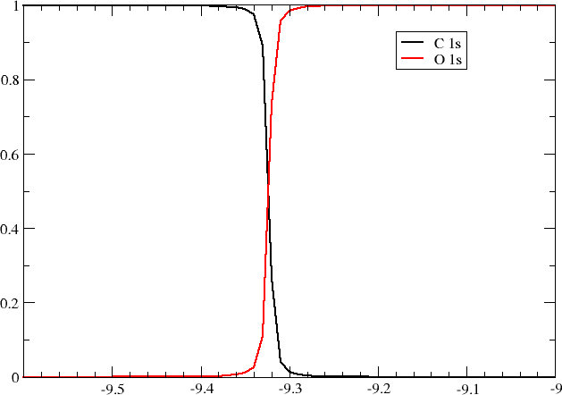

:orphan:

Atomic shift operator
=====================

DIRAC allows the definition of an atomic shift operator :ref:`HAMILTONIAN_.ASHIFT` to be added to the Hamiltonian

.. math::

   V = \sum_{A}\sum_{I\in A}\sum_{i\in I}|\varphi^A_i\rangle \varepsilon^A_I \langle \varphi^A_i|

where :math:`A` is a sum over atomic types. For each atomic types a group :math:`I` of orbitals may be
specified with an associated shift parameter :math:`\varepsilon^A_I`. In this manual we shall see
an example of its use.

Degeneracy-driven covalency: the case of CO
-------------------------------------------

We consider carbon monoxide. We run a straightforward HF calculation using the input files *CO.xyz* 

.. literalinclude:: CO.xyz

and *CO.inp* 

.. literalinclude:: CO.inp

using the command::		    

   pam --inp=CO --mol=CO.xyz

Looking at the Mulliken population analysis in the output, we find for the lowest two occupied molecular orbitals::

  * Electronic eigenvalue no.   1: -20.684805978278       (Occupation : f = 1.0000)  m_j=  1/2
  ============================================================================================
  
  * Gross populations greater than 0.01000
  
  Gross     Total   |    L A1 O  s   
  --------------------------------------
   alpha    0.9995  |      0.9992
   beta     0.0005  |      0.0000
  
  * Electronic eigenvalue no.   2: -11.369805624916       (Occupation : f = 1.0000)  m_j=  1/2
  ============================================================================================
  
  * Gross populations greater than 0.01000
  
  Gross     Total   |    L A1 C  s   
  --------------------------------------
   alpha    0.9997  |      0.9990
   beta     0.0003  |      0.0000

We see that the first and second lowest occupied MO are :math:`O1s` and :math:`C1s`, respectively, separated by a sizable energy of :math:`9.315\ E_h`.
     
Let us now see what happens if we bring the two atomic core orbitals into resonance. First we
generate the carbon atomic orbitals, using input files *C.inp* 

.. literalinclude:: C.xyz

and *C.inp* 

.. literalinclude:: C.inp

and the command::		    

   pam --inp=C --mol=C.xyz 

The checkpoint file *C_C.h5* contains the :math:`C_1` coefficients::

  h5dump -n C_C.h5 | grep C1
   dataset    /result/wavefunctions/scf/mobasis/eigenvalues_C1
   dataset    /result/wavefunctions/scf/mobasis/orbitals_C1
   
We next prepare the input file *COshift.inp*

.. literalinclude:: COshift.inp

which notably defines an atomic shift operator for carbon which builds a projector from the :math:`C1s` orbital and shifts it down by :math:`9.315\ E_h`. We run our calculation using the command::

  pam 	--inp=COshift --mol=CO.xyz --put "ac.C=AFCXXX"

The Mulliken population analysis of the two lower orbitals now read::

   * Electronic eigenvalue no.  1: -20.687541416409       (Occupation : f = 1.0000)  m_j=  1/2
   ==========================================================================================
   
   * Gross populations greater than 0.00010
   
   Gross     Total   |    L A1 C  s      L A1 O  s      A1 O  _small   B1 O  _small   B2 O  _small
   --------------------------------------------------------------------------------------------------
    alpha    0.9996  |      0.4790         0.5203         0.0001         0.0000         0.0000
    beta     0.0004  |      0.0000         0.0000         0.0000         0.0001         0.0001
   
   * Electronic eigenvalue no.  2: -20.681935936276       (Occupation : f = 1.0000)  m_j=  1/2
   ==========================================================================================
   
   * Gross populations greater than 0.00010
   
   Gross     Total   |    L A1 C  s      L A1 O  s      A1 O  _small   B1 O  _small   B2 O  _small
   --------------------------------------------------------------------------------------------------
    alpha    0.9996  |      0.5202         0.4790         0.0001         0.0000         0.0000
    beta     0.0004  |      0.0000         0.0000         0.0000         0.0001         0.0001

and we indeed see that the two lowest molecular orbitals now are almost degenerate with concomitant strong mixing of the :math:`O1s` and :math:`C1s` orbitals.

By scanning shift values in the resonance region we obtain the following plot of orbital energies of the two lowest occupied molecular orbitals

.. image:: COshift_eig.png
    :width: 600px

as well as the mixing of :math:`O1s` and :math:`C1s` orbitals in the LOMO.

At this point it may be useful to consider the diagonalization of a :math:`2\times2` matrix

.. math::

   \left[\begin{array}{cc}\varepsilon_1&\delta\\\delta&\varepsilon_2\end{array}\right],

where eigenvalues are given by

.. math::

   \lambda_\pm = \frac{1}{2}\left[(\varepsilon_1+\varepsilon_2)\pm\sqrt{(\varepsilon_1-\varepsilon_2)^2 +4\delta^2}\right];\quad\Delta\lambda=\sqrt{(\varepsilon_1-\varepsilon_2)^2 +4\delta^2}

We notably see that as we bring the two starting energies into resonance, that is :math:`\varepsilon_1=\varepsilon_2`, the difference :math:`\Delta\lambda` becomes equal to the    
twice the interaction :math:`2|\delta|`. In this particular case :math:`2|\delta|=5.6\ mE_h`.

What can learn from this ? Neidig, Clark and Martin :cite:`Neidig_CoorChemRev2013` have introduced
the concept of *near-degeneracy driven covalency*, where bonding interaction arises from near-degeneracy, even in the absence of overlap. In the above example we clearly see this mechanism at work: bringing the :math:`O1s` and :math:`C1s` orbitals into resonance causes strong orbital mixing.
*However*, it would be absurd to call this bonding. The two atomic core orbitals can be disentangled by localization and we also note that their interaction is extremely weak.

		      
