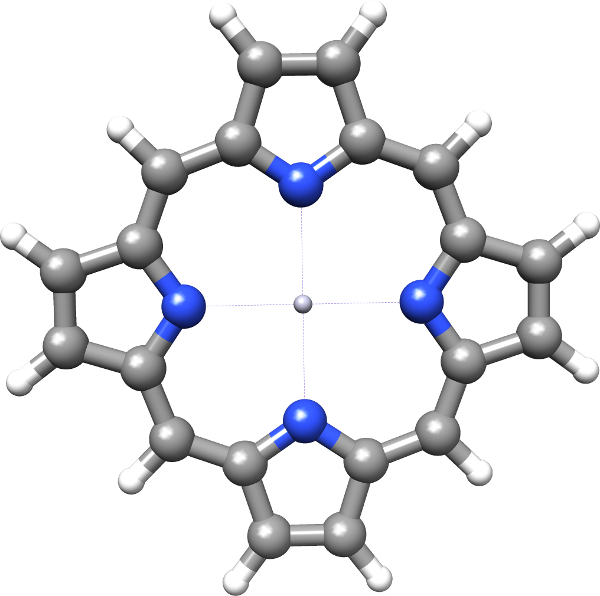

Atomic start guess
==================

Initial SCF run
---------------

We consider the Hartree-Fock calculation of porphyrin with a mercury center

The SCF input file ``HF.inp`` reads::

  **DIRAC
  .WAVE FUNCTION
  .ANALYZE
  **WAVE FUNCTIONS
  .SCF
  *SCF
  .MAXITR
  20
  .PRINT 
  2
  .CLOSED SHELL
  120 120
  **ANALYZE
  .MULPOP
  *END OF

The calculations are carried out in D2h symmetry, so that the Fock matrix is real. From the output file we read::

  Atoms and basis sets
  --------------------

  Number of atom types:     4
  Total number of atoms:   37

    label    atoms   charge   prim    cont     basis
    ----------------------------------------------------------------------
    N2          4       7      22       9      L  - [10s4p|3s2p]
                               58      58      S  - [4s10p4d|4s10p4d]
    C5         20       5      22       9      L  - [10s4p|3s2p]
                               58      58      S  - [4s10p4d|4s10p4d]
    H3         12       1       4       2      L  - [4s|2s]
                               12      12      S  - [4p|4p]
    Hg          1      80     282     282      L  - [23s23p15d10f|23s23p15d10f]
                              635     635      S  - [23s38p33d15f10g|23s38p33d15f10g]
    ----------------------------------------------------------------------
                              858     522      L  - large components
                             2171    2171      S  - small components
    ----------------------------------------------------------------------
    total:     37     220    3029    2693

showing that in AO-basis the Fock-matrix has the dimension 2693 x 2693
and thus requires 7252249 words. The SCF run will require something like three Fock matrices,
so in this case 21 Mwords.

Preparing the atomic start
--------------------------
For each atom we run a SCF calculation in full (linear) symmetry based on the atomic ground state configuration.
For open-shell atoms this amounts to an average-of-configuration (AOC) calculation at the HF level, and a fractional
occupation calculation at the DFT level.

