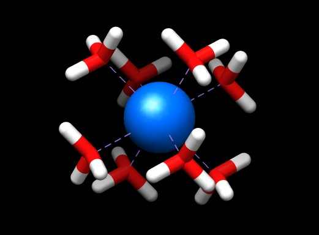

Atomic start guess
==================

Initial SCF run
---------------

We consider the Hartree-Fock calculation of plutonium dixode cluster

In order to help convergence we will employ an atomic start.

Preparing the atomic start
--------------------------
For each atom we run a SCF calculation in full (linear) symmetry based on the atomic ground state configuration.
For open-shell atoms this amounts to an average-of-configuration (AOC) calculation at the HF level, and a fractional
occupation calculation at the DFT level. 

Hydrogen atom
~~~~~~~~~~~~~

The input file ``h.inp`` reads: ::

  **DIRAC
  .WAVE FUNCTION
  .ANALYZE
  **GENERAL
  .ACMOUT
  **HAMILTONIAN
  .ONESYS
  **WAVE FUNCTIONS
  .SCF
  *SCF
  .CLOSED SHELL
  2 0
  **ANALYZE
  .MULPOP
  *END OF

The molecular input ``h.mol`` is ::

  BASIS
  
  
  C   1              A
          1.    1
  H      0.0000000000        0.0000000000        0.0000000000
  LARGE BASIS cc-pVDZ
  FINISH

We run pam ::

  pam --inp=h.inp --mol=h.mol --get=ACMOUT
  mv DFACMO ac.H

Oxygen atom
~~~~~~~~~~~

The input file ``o.inp`` reads: ::

  **DIRAC
  .WAVE FUNCTION
  .ANALYZE
  **GENERAL
  .ACMOUT
  **WAVE FUNCTIONS
  .SCF
  *SCF
  .CLOSED SHELL
  4 0
  .OPEN SHELL 
  1
  4/0,6
  **ANALYZE
  .MULPOP
  *END OF

The molecular input ``o.mol`` is ::

  BASIS
  
  
  C   1              A
          8.    1
  O      0.0000000000        0.0000000000        0.0000000000
  LARGE BASIS cc-pVDZ
  FINISH

We run the calculation ::

  pam --inp=o.inp --mol=o.mol --get=DFACMO
  mv DFACMO ac.O

Plutonium atom
~~~~~~~~~~~~~~

For plutonium we employ the :math:`[Rn]5f^4` configuration of the :math:`Pu^{4+}` cation. The input file ``pu.inp`` accordingly reads: ::

  **DIRAC
  .WAVE FUNCTION
  .ANALYZE
  **GENERAL
  .ACMOUT
  **WAVE FUNCTIONS
  .SCF
  *SCF
  .CLOSED SHELL
  42 44
  .OPEN SHELL
  1
  4/0,14
  **INTEGRALS
  *READIN
  .UNCONTRACT
  **ANALYZE
  .MULPOP
  *END OF

The molecular file 'pu.mol' reads ::

  BASIS
  
  
  C   1              A
         94.    1
  Pu     0.0000000000        0.0000000000        0.0000000000
  LARGE BASIS dyall.v2z
  FINISH

All atoms can be run in a single shot, e.g. using bash ::

  for atom in H C N Hg   
  do
    pam --mol=${atom}.mol --inp=${atom}.inp --get=DFACMO
    mv DFACMO ac.${atom}
  done   

We are now ready to run the atomic start.

Running the atomic start
------------------------

The input file ``atomstart.inp`` reads ::

  **DIRAC
  .WAVE FUNCTION
  .ANALYZE
  **WAVE FUNCTIONS
  .SCF
  *SCF
  .ATOMST
  AFNXXX 2
  1,2
  1.00
  3..5
  0.33
  AFCXXX 2
  1,2
  1.00
  3..5
  0.5
  AFHXXX 1
  1
  0.5
  AFHGXX 1
  1..40
  1.00
  .CLOSED SHELL
   120 120
  **ANALYZE
  .MULPOP
  *END OF

The keyword ``ATOMST`` is followed by input for each atomic type. The occupations chosen corresponds to those of the atomic runs, 
but the user may modify this at will. 

Before running the calculation the user must make provide links to the atomic coefficient files ::

  ln -s ac.N AFNXXX
  ln -s ac.C AFCXXX
  ln -s ac.H AFHXXX
  ln -s ac.Hg AFHGXX

and the calculation is then run as ::

  pam --mol=hg-porphyrin.mol --inp=atomstart.inp --copy="AF*" --outcmo

This calculation converges smoothly after 19 iterations ::

                                     SCF - CYCLE
                                     -----------
  
  * Convergence on norm of error vector (gradient).
    Desired convergence:1.000D-07
    Allowed convergence:1.000D-06
  
  * ERGVAL - convergence in total energy
  * FCKVAL - convergence in maximum change in total Fock matrix
  * EVCVAL - convergence in error vector (gradient)
  --------------------------------------------------------------------------------------------------------------------------------
             Energy               ERGVAL    FCKVAL    EVCVAL      Conv.acc    CPU          Integrals   Time stamp
  --------------------------------------------------------------------------------------------------------------------------------
  
  It.    1    -20635.00776527      2.06D+04  0.00D+00  0.00D+00   Atomic s    2min21.424s   LL SL          Sat Oct 20
  It.    2    -20617.25046461     -1.78D+01 -4.12D+00  6.18D+00               4min 9.393s   LL SL          Sat Oct 20
  It.    3    -20627.70080840      1.05D+01  2.30D+00  4.46D+00   DIIS   2    4min 0.022s   LL SL          Sat Oct 20
  It.    4    -20632.90678695      5.21D+00  2.22D+00  1.75D+00   DIIS   3    3min59.067s   LL SL          Sat Oct 20
  It.    5    -20633.37964110      4.73D-01 -1.12D+00  6.25D-01   DIIS   4    4min16.283s   LL SL          Sat Oct 20
  It.    6    -20633.41423594      3.46D-02  1.30D-01  1.84D-01   DIIS   5    4min 9.022s   LL SL          Sat Oct 20
  It.    7    -20633.42117808      6.94D-03  4.27D-02  3.46D-02   DIIS   6    3min40.493s   LL SL          Sat Oct 20
  It.    8    -20633.42172290      5.45D-04 -6.60D-03  1.27D-02   DIIS   7    4min 3.693s   LL SL          Sat Oct 20
  It.    9    -20633.42177741      5.45D-05  4.78D-03  6.35D-03   DIIS   8    3min56.721s   LL SL          Sat Oct 20
  It.   10    -20633.42179046      1.30D-05 -2.29D-03  1.85D-03   DIIS   9    3min36.614s   LL SL          Sat Oct 20
  It.   11    -20633.42179244      1.98D-06 -3.30D-04  6.63D-04   DIIS   9    3min21.307s   LL SL          Sat Oct 20
  It.   12    -20633.42179279      3.47D-07 -1.02D-04  3.77D-04   DIIS   9    3min29.188s   LL SL          Sat Oct 20
  It.   13    -20633.42179286      7.29D-08  1.16D-04  9.16D-05   DIIS   9    4min12.375s   LL SL          Sat Oct 20
  It.   14    -20633.42179287      8.34D-09 -2.26D-05  3.85D-05   DIIS   9    3min 4.548s   LL SL          Sat Oct 20
  It.   15    -20633.42179287      1.03D-09  9.69D-06  7.69D-06   DIIS   9    2min58.304s   LL SL          Sat Oct 20
  It.   16    -20633.42179287      8.00D-11  7.15D-07  2.96D-06   DIIS   9    2min47.463s   LL SL          Sat Oct 20
  It.   17    -20633.42179287      4.69D-10 -6.91D-07  9.83D-07   DIIS   9    2min42.349s   LL SL          Sat Oct 20
  It.   18    -20633.42179287     -1.16D-10  4.14D-07  2.78D-07   DIIS   9    2min42.616s   LL SL          Sat Oct 20
  It.   19    -20633.42179287     -2.58D-10 -3.43D-08  7.47D-08   DIIS   9    2min19.392s   LL SL          Sat Oct 20
  --------------------------------------------------------------------------------------------------------------------------------

