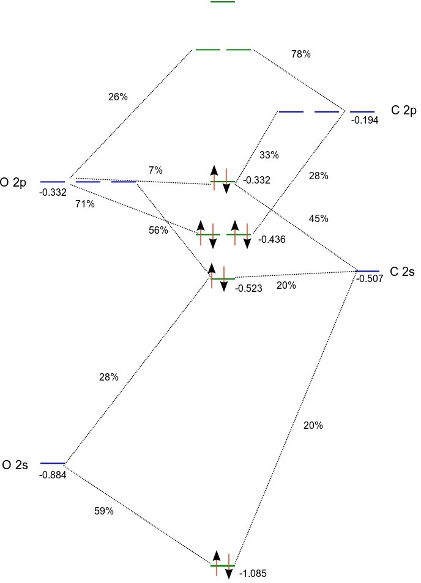

A TDDFT study of carbon monoxide
================================

Introduction
------------

To illustrate the TDDFT capabilities of DIRAC we will consider excited states of the carbon monoxide molecule. 
The experimental spectrum can be found `here <http://webbook.nist.gov/cgi/cbook.cgi?Formula=CO&NoIon=on&Units=SI&cDI=on>`_ .
Note that this source gives only adiabatic excitation energies :math:`T_e`, that is, the energy difference between the 
minima of the potential curve of the ground and excited state, whereas the TDDFT calculations give vertical excitation
energies :math:`T_v`. The experimental adiabatic excitation energies has been converted to vertical ones by [Nielsen_JCP1980]_.
We will begin this tutorial in spinfree mode to faciliate the connection to the non-relativistic domain.
In the following we employ the molecular input file `CO.mol` ::

  INTGRL
  Carbon monoxide
  Dunning aug-cc-pVDZ
  C   2              A
          6.    1
  C        0.0000000000000     0.0000000000000     0.0000000000000
  LARGE BASIS aug-cc-pVDZ
          8.    1
  O        0.0000000000000     0.0000000000000     1.128323
  LARGE BASIS aug-cc-pVDZ
  FINISH

Here we do not provide any symmetry information, meaning that we ask DIRAC to detect it.
DIRAC will find that the full group is :math:`C_{\infty v}`. With spin-orbit coupling DIRAC
will then activate linear supersymmetry, but in the spin-orbit free case it will simply use
the highest Abelian single point group, that is :math:`C_{2v}`. Irreps of :math:`C_{\infty v}` and :math:`C_{2v}` 
correlate as follows:

+----------------------+------------------+
| :math:`C_{\infty v}` | :math:`C_{2v}`   |
+======================+==================+
| :math:`\Sigma^{+}`   | :math:`A1`       |
+----------------------+------------------+
| :math:`\Sigma^{-}`   | :math:`A2`       |
+----------------------+------------------+
| :math:`\Pi`          | :math:`B_1, B_2` |
+----------------------+------------------+
| :math:`\Delta`       | :math:`A_1, A_2` |
+----------------------+------------------+

Ground state electronic structure
---------------------------------

Before actually doing TDDFT let us first have a look at the electronic structure of the ground state of CO.
We therefore carry out Kohn-Sham DFT using the PBE functional and the eXact 2-Component (X2C) Hamiltonian 
followed by Mulliken population analysis using the input file `PBE.inp` ::

  **DIRAC
  .TITLE
  CO
  .WAVE FUNCTIONS
  .ANALYZE
  **HAMILTONIAN
  .SPINFREE
  .X2C
  .DFTAUTO    ! uses xcfun
  PBE
  **INTEGRALS
  *TWOINT
  .SCREEN
  1.0D-12
  *READIN
  .UNCONT
  **WAVE FUNCTIONS
  .SCF
  *SCF
  .CLOSED SHELL
  14
  **ANALYZE
  .MULPOP
  *MULPOP
  .VECPOP
  1..10
  *END OF

Based on orbital energies and the Mulliken population analysis we can set up the following MO diagram:

(Orbital energies for the atoms were obtained from atomic calculations using fractional occupation)

According to the above MO diagram the valence electron configuration of carbon monoxide is
:math:`1\sigma^{2}2\sigma^{2}1\pi^{4}3\sigma^{2}`. From projection analysis we find that the electron configurations
of the carbon and oxygen atoms in the molecule are :math:`1s^{2.0}2s^{2.0}2p^{2.0}` and :math:`1s^{2.0}2s^{1.7}2p^{4.3}` , respectively, 
with a slight negative charge of -0.3 on oxygen. We note that the HOMO is a :math:`\sigma` orbital dominated (~90 %) by carbon (2s,2p), 
whereas the doubly degenerate LUMO is a :math:`\pi` orbital with about 75% C *2p* and 25% O *2p*. The LUMO+1 is :math:`\sigma` orbital
with a combination of carbon and oxygen *3s* dominated by the former atom.

Excited states
--------------

Preparing the input files
~~~~~~~~~~~~~~~~~~~~~~~~~

The excited states will be calculated in a "bottoms-up" fashion for each irrep by expansion of the solution vector in trial vector [Bast2009]_.
For each irrep the user specifies the number of desired excitations. It may be a good idea of including some extra excitations in case of
root flipping during the iterative solution of the TDDFT equations. We are working within the adiabatic approximation of TDDFT
and consider single excitations from a closed-shell ground state. The final states will be therefore be singlet or triplets in the spin-orbit 
free case. We need to tell DIRAC how these states are distributed on the four irreps of :math:`C_{2v}`. 
At this point we should emphasize that DIRAC will employ the *total* symmetry of the final states,
that is the combined spin and spatial symmetry. A singlet spin function is totally symmetric (:math:`A_1`), whereas the
triplet spin functions transform as rotations. We know the triplet functions as:

.. math::

   T_{-1} = \alpha_1\alpha_2;\quad T_0=\frac{1}{\sqrt{2}}\left(\alpha_1\beta_2-\beta_1\alpha_2\right);\quad T_{+1}=\beta_1\beta_2

but for our purposes it will be more convenient to form the combinations:

.. math::

   T_x=\frac{1}{\sqrt{2}}\left(T_{-1}-T_{+1}\right);\quad T_y=\frac{i}{\sqrt{2}}\left(T_{-1}+T_{+1}\right);\quad T_z=T_0

which transform as rotations :math:`R_x\left(B_{2}\right)` , :math:`R_y\left(B_{1}\right)` and :math:`R_z\left(A_{2}\right)` , respectively. 
For a given point group you find the symmetry of the rotations in most standard character tables (for instance 
`here <http://www.webqc.org/symmetry.php>`_ ).

As an example of how to determine total symmetry of the final states let us consider single excitations
HOMO into the LUMO (:math:`\pi`) and LUMO+1 (:math:`\sigma`) orbitals. This leads to :math:`2 \times\ 6 = 12` 
determinants which translate into the following final states:

+---------------------------------+----------------------+
| Configuration                   | States               |
+=================================+======================+
| :math:`3\sigma^{-1}2\pi^{1}`    | :math:`^{1,3}\Pi`    |
+---------------------------------+----------------------+
| :math:`3\sigma^{-1}4\sigma^{1}` | :math:`^{1,3}\Sigma` |
+---------------------------------+----------------------+

We can now set up the following correlation of states:

+----------------------+-----------------------------+----------------------+------------------------------------------------------------------+  
| State                | Spin                        | Spatial              | Spin :math:`\otimes` Spatial                                     |
+======================+=============================+======================+==================================================================+  
|  :math:`^1\Sigma`    | :math:`A_1`                 | :math:`A_1`          | :math:`A_1`                                                      |
+----------------------+-----------------------------+----------------------+------------------------------------------------------------------+  
|  :math:`^1\Pi_{x,y}` | :math:`A_1`                 | :math:`B_{1}, B_{2}` | :math:`B_{1}, B_{2}`                                             |
+----------------------+-----------------------------+----------------------+------------------------------------------------------------------+
|  :math:`^3\Sigma`    | :math:`B_{2}, B_{1}, A_{2}` | :math:`A_1`          | :math:`B_{2}, B_{1}, A_{2}`                                      |
+----------------------+-----------------------------+----------------------+------------------------------------------------------------------+  
|  :math:`^3\Pi_{x,y}` | :math:`B_{2}, B_{1}, A_{2}` | :math:`B_{1}, B_{2}` | :math:`\left(A_2, A_{1}, B_2\right), \left(A_1, A_2, B_2\right)` |
+----------------------+-----------------------------+----------------------+------------------------------------------------------------------+  

(The group multiplication table is found in the DIRAC output.)

Counting total symmetries we find that the 12 microstates are evenly distributed amongst the four irreps of :math:`C_{2v}`:

+---+------------+-------------------------------------------------------+
|   | Irrep      | Valence-excited state                                 |
+===+============+=======================================================+
| 1 |:math:`A_1` | :math:`^1\Sigma, ^{3(y)}\Pi_{x}, ^{3(x)}\Pi_{y}`      |
+---+------------+-------------------------------------------------------+
| 2 |:math:`B_1` | :math:`^{1}\Pi_{x}, ^{3(y)}\Sigma, ^{3(z)}\Pi_{y}`    |
+---+------------+-------------------------------------------------------+
| 3 |:math:`B_2` | :math:`^{1}\Pi_{y}, ^{3(x)}\Sigma, ^{3(z)}\Pi_{x}`    |
+---+------------+-------------------------------------------------------+
| 4 |:math:`A_2` | :math:`^{3(z)}\Sigma, ^{3(x)}\Pi_{x}, ^{3(y)}\Pi_{y}` |
+---+------------+-------------------------------------------------------+

Note that the order of the irreps follows the output of DIRAC. 

We now set up the following menu file for our calculation::

  **DIRAC
  .TITLE
  CO
  .WAVE FUNCTIONS
  .ANALYZE
  .PROPERTIES
  **HAMILTONIAN
  .SPINFREE
  .X2C
  .DFT
  CAMB3LYP
  **INTEGRALS
  *READIN
  .UNCONT
  **WAVE FUNCTIONS
  .SCF
  *SCF
  .CLOSED SHELL
  14
  **ANALYZE
  .MULPOP
  *MULPOP
  .VECPOP
  1..10
  **PROPERTIES
  *EXCITATION
  #A1 :
  .EXCITA
  1 10
  #B1 :
  .EXCITA
  2 10
  #B2 :
  #.EXCITA
  #3 10
  #A2 :
  .EXCITA
  4 10
  .ANALYZE
  .OPERATOR
   XDIPLEN
  .OPERATOR
   YDIPLEN
  .OPERATOR
   ZDIPLEN
  *END OF

Note that we skip excitations in :math:`B_{2}` since they are related by symmetry to the excitations of :math:`B_{1}`.
On the other hand we ask for 10 excitations in the other symmetries. We base our TDDFT calculation on the long-range corrected CAMB3LYP
functional [Yanai_CPL2004]_ which provides a better description of Rydberg and charge-transfer excitations than 
standard continuum functionals. 
We furthermore ask for transition moments to be calculated with respect to the component of the dipole moment operator.
These will be non-zero only for excitations in irreps :math:`B_{1}, B_{2}` and :math:`A_{1}`.
Finally we ask for analysis of what orbitals contribute to the various excitations. 
For this the Mulliken population analysis may come in handy as reference.

Looking at the output
~~~~~~~~~~~~~~~~~~~~~

After running the calculation, let us now look at the output. Let us take the final output of excitations
of :math:`A_1` symmetry as an example::

  ================================================================================
  
   *** Excitations of boson symmetry 1 : A1 
  
  --------------------------------------------------------------------------------
   Excitation no.   1 excitation energy     0.21796849 a.u.    2.89E-06 (converged)
   Nonrel. sym.:   TxB2                         5.9312 eV
   *** Transition moments <0|A|n> for this excitation:
  
   A - ZDIPLEN              A1   T+         0.00000000D+00 a.u.
  --------------------------------------------------------------------------------
   Excitation no.   2 excitation energy     0.21796849 a.u.    6.32E-06 (converged)
   Nonrel. sym.:   TyB1                         5.9312 eV
   *** Transition moments <0|A|n> for this excitation:
  
   A - ZDIPLEN              A1   T+         0.00000000D+00 a.u.
  --------------------------------------------------------------------------------
   Excitation no.   3 excitation energy     0.31960825 a.u.    5.31E-06 (converged)
   Nonrel. sym.:   TzA2                         8.6970 eV
   *** Transition moments <0|A|n> for this excitation:
  
   A - ZDIPLEN              A1   T+         0.00000000D+00 a.u.
  --------------------------------------------------------------------------------
   Excitation no.   4 excitation energy     0.35719034 a.u.    9.84E-06 (converged)
   Nonrel. sym.:   TzA2                         9.7196 eV
   *** Transition moments <0|A|n> for this excitation:
  
   A - ZDIPLEN              A1   T+         0.00000000D+00 a.u.
  --------------------------------------------------------------------------------
   Excitation no.   5 excitation energy     0.37137212 a.u.    2.71E-06 (converged)
   Nonrel. sym.:   S0A1                        10.1055 eV
   *** Transition moments <0|A|n> for this excitation:
  
   A - ZDIPLEN              A1   T+         0.75578153D-10 a.u.
  --------------------------------------------------------------------------------
   Excitation no.   6 excitation energy     0.40056879 a.u.    3.42E-06 (converged)
   Nonrel. sym.:   S0A1                        10.9000 eV
   *** Transition moments <0|A|n> for this excitation:
  
   A - ZDIPLEN              A1   T+        -0.100967888969 a.u.
  
       -> dipole oscillator strength (length)   :  0.00272240
       -> dipole oscillator strength (velocity) :  0.00000000
  
       Total dipole radiation rate (length)   1.40352E+07 s-1
        - corresponding radiation life time   7.12496E-08 s
  --------------------------------------------------------------------------------
   Excitation no.   7 excitation energy     0.41485654 a.u.    4.09E-06 (converged)
   Nonrel. sym.:   S0A1                        11.2888 eV
   *** Transition moments <0|A|n> for this excitation:
  
   A - ZDIPLEN              A1   T+         0.850545002869 a.u.
  
       -> dipole oscillator strength (length)   :  0.20007889
       -> dipole oscillator strength (velocity) :  0.00000000
  
       Total dipole radiation rate (length)   1.10639E+09 s-1
        - corresponding radiation life time   9.03841E-10 s
  --------------------------------------------------------------------------------
   Excitation no.   8 excitation energy     0.41547529 a.u.    2.39E-06 (converged)
   Nonrel. sym.:   TxB2                        11.3057 eV
   *** Transition moments <0|A|n> for this excitation:
  
   A - ZDIPLEN              A1   T+         0.00000000D+00 a.u.
  --------------------------------------------------------------------------------
   Excitation no.   9 excitation energy     0.41547529 a.u.    3.46E-06 (converged)
   Nonrel. sym.:   TyB1                        11.3057 eV
   *** Transition moments <0|A|n> for this excitation:
  
   A - ZDIPLEN              A1   T+         0.00000000D+00 a.u.
  --------------------------------------------------------------------------------
   Excitation no.  10 excitation energy     0.44215019 a.u.    3.79E-06 (converged)
   Nonrel. sym.:   TxB2                        12.0315 eV
   *** Transition moments <0|A|n> for this excitation:
  
   A - ZDIPLEN              A1   T+         0.00000000D+00 a.u.
  ================================================================================
  
There is sufficient symmetry in the calculation (symmetry distinct rotations) to allow DIRAC to pinpoint
the symmetry of the valence-excited states (see the entry `Nonrel. sym.`). The triplet states have strictly
zero transition moment (and thus intensity), whereas the sixth and seventh states are singlet states with
non-zero transition moments. We can also look at a snippet from the excitation analysis::

  ** E solution vectors : PP EXCITATIONA1  Irrep: A1  Trev:   1 Length:        441
   Freq.:   0.217968 Norm:   0.71160560E+00 Residual norm:   0.29E-05
     Dominant inactive orbitals: 
       7(E1 ) 99.56%
     Dominant virtual orbitals:
       8(E1 ) 87.92%
      13(E1 ) 10.80%
     Excitation amplitudes larger than threshold   0.34E-01

          7(i:E1 ) --->      8(v:E1 )  0.66634909E+00
          7(i:E1 ) --->     13(v:E1 )  0.23316934E+00
          7(i:E1 ) --->     15(v:E1 )  0.55294899E-01
          7(i:E1 ) --->     24(v:E1 )  0.41863354E-01
          4(i:E1 ) --->      8(v:E1 )  0.34733952E-01

We see that for each excitation we get information about the dominant occupied and virtual orbitals.
The character of each orbital can be found from Mulliken population analysis or from projection analysis.

In order to properly identify the excited states we collect data from the four irreps and list the states
in order of increasing excitation energy. This gives the following table:

+-----+----------+----------------------------------------------------+--------------------------------+
| Level (eV)     | Symmetry                                           | Dominant orbitals              |
+=====+==========+====================================================+================================+
|   1 |   5.9312 |   A1(TxB2), A1(TyB1), B1(TzB2), A2(TyB2), A2(TxB1) | :math:`7\rightarrow (8,9)`     |
+-----+----------+----------------------------------------------------+--------------------------------+
|   2 |   7.9482 |   B1(TyA1), A2(TzA1)                               | :math:`(5,6)\rightarrow (8,9)` |
+-----+----------+----------------------------------------------------+--------------------------------+
|   3 |   8.4859 |   B1(S0B1)                                         | :math:`7 \rightarrow (8,9)`    |
+-----+----------+----------------------------------------------------+--------------------------------+
|   4 |   8.6970 |   A1(TzA2), B1(TxA2), B1(TyA1), A2(TzA1)           | :math:`(5,6)\rightarrow (8,9)` |
+-----+----------+----------------------------------------------------+--------------------------------+
|   5 |   9.7196 |   A1(TzA2), B1(TxA2), A2(S0A2)                     | :math:`(5,6)\rightarrow (8,9)` |
+-----+----------+----------------------------------------------------+--------------------------------+
|   6 |  10.1055 |   A1(S0A1), A2(S0A2)                               | :math:`(5,6)\rightarrow (8,9)` |
+-----+----------+----------------------------------------------------+--------------------------------+
|   7 |  10.2650 |   B1(TyA1), A2(TzA1)                               | :math:`7\rightarrow 10,11`     |
+-----+----------+----------------------------------------------------+--------------------------------+
|   8 |  10.9000 |   A1(S0A1)                                         | :math:`7\rightarrow 10`        |
+-----+----------+----------------------------------------------------+--------------------------------+
|   9 |  11.0348 |   B1(TyA1), A2(TzA1)                               | :math:`7\rightarrow 11`        |
+-----+----------+----------------------------------------------------+--------------------------------+
|  10 |  11.2888 |   A1(S0A1)                                         | :math:`7\rightarrow 11`        |
+-----+----------+----------------------------------------------------+--------------------------------+
|  11 |  11.3057 |   A1     TxB2, TyB1, TzB2                          | :math:`7\rightarrow (12,13)`   |
+-----+----------+----------------------------------------------------+--------------------------------+
|  12 |  11.4598 |   B1     S0B1                                      | :math:`7\rightarrow (12,13)`   |           
+-----+----------+----------------------------------------------------+--------------------------------+
|  13 |  12.0315 |   A1     TxB2                                      | :math:`4\rightarrow (8,9)`     |
+-----+----------+----------------------------------------------------+--------------------------------+

from which we identify 13 energy levels. Keeping in mind that for every excitation of total symmetry :math:`B_1` there is 
a :math:`B_2` partner we now consider each energy level:

1. The first level has six-fold degeneracy and is a triplet. The space symmetries are :math:`B_1` and :math:`B_2` 
   and from the correspondence table between :math:`C_{2v}` and :math:`C_{\infty v}` we identify it as :math:`^{3}\Pi`.
   The dominant excitation is :math:`3\sigma \rightarrow 2\pi`.
2. The second level is a triplet of three-fold degeneracy identified as :math:`^{3}\Sigma^{+}`. The dominant excitation is :math:`1\pi \rightarrow 2\pi`.
3. The third level is a singlet of two-fold degeneray identified as :math:`^{1}\Pi`. The dominant excitation is :math:`3\sigma \rightarrow 2\pi`.
4. The first level has six-fold degeneracy and is a triplet. The space symmetries are :math:`A_1` and :math:`A_2` 
   and from the correspondence table between :math:`C_{2v}` and :math:`C_{\infty v}` we identify it as :math:`^{3}\Delta`. The dominant excitation is :math:`1\pi \rightarrow 2\pi`.
5. The fifth level consists of a singlet and a triplet, so two separate electronic states, namely :math:`^{1}\Sigma^{-}`
   and :math:`^{3}\Sigma^{-}`. The dominant excitation is :math:`1\pi \rightarrow 2\pi`.
6. The sixth level is a doubly-degenerate singlet identified as :math:`^{1}\Delta`. The dominant excitation is :math:`1\pi \rightarrow 2\pi`.
7. :math:`^{3}\Sigma^{+}`. The dominant excitation is :math:`3\sigma \rightarrow 4\sigma`. The :math:`4\sigma` orbital is dominated by  *3s* from both atoms, but with some *3s* character as well.
8. :math:`^{1}\Sigma^{+}`. The dominant excitation is :math:`3\sigma \rightarrow 4\sigma`. 
9. :math:`^{3}\Sigma^{+}`. The dominant excitation is :math:`3\sigma \rightarrow 5\sigma`. The :math:`5\sigma` orbital is dominated by  *3p* from both atoms, but with some *3p* character as well.
10. :math:`^{1}\Sigma^{+}`. The dominant excitation is :math:`3\sigma \rightarrow 5\sigma`.
11. :math:`^{3}\Pi`. The dominant excitation is :math:`3\sigma \rightarrow 3\pi`, the latter dominated by carbon *3p*.
12. :math:`^{1}\Pi`.The dominant excitation is :math:`3\sigma \rightarrow 3\pi`.

The assignment and energy of states may be compared to [Tozer_JCP1998]_. Below we give a summary of results obtained with a variety of functionals available in DIRAC.

+------------------------------+-------------+-------------+----------+-------+-------+-------+-------+-------+
|                              | :math:`T_e` | :math:`T_v` | CAMB3LYP | LDA   | PBE   | PBE0  | BLYP  | B3LYP |
+==============================+=============+=============+==========+=======+=======+=======+=======+=======+
| :math:`a\ ^{3}\Pi`           | 6.04        | 6.32        | 5.93     | 5.98  | 5.77  | 5.76  | 5.85  | 5.88  |
+------------------------------+-------------+-------------+----------+-------+-------+-------+-------+-------+
| :math:`a\ ^{3}\Sigma^{+}`    | 6.92        | 8.51        | 7.95     | 8.43  | 8.12  | 7.85  | 8.10  | 7.93  |
+------------------------------+-------------+-------------+----------+-------+-------+-------+-------+-------+
| :math:`A\ ^{1}\Pi`           | 8.07        | 8.51        | 8.49     | 8.19  | 8.26  | 8.45  | 8.25  | 8.41  |
+------------------------------+-------------+-------------+----------+-------+-------+-------+-------+-------+
| :math:`d\ ^{3}\Delta`        | 7.58        | 9.36        | 8.70     | 9.21  | 8.78  | 8.64  | 8.72  | 8.66  |
+------------------------------+-------------+-------------+----------+-------+-------+-------+-------+-------+
| :math:`e\ ^{3}\Sigma^{-}`    | 7.96        | 9.88        | 9.72     | 9.89  | 9.87  | 9.79  | 9.79  | 9.73  |
+------------------------------+-------------+-------------+----------+-------+-------+-------+-------+-------+
| :math:`I\ ^{1}\Sigma^{-}`    | 8.07        | 9.88        | 9.72     | 9.89  | 9.87  | 9.79  | 9.79  | 9.73  |
+------------------------------+-------------+-------------+----------+-------+-------+-------+-------+-------+
| :math:`D\ ^{1}\Delta`        | 8.17        | 10.23       | 10.11    | 10.36 | 10.21 | 10.21 | 10.03 | 10.05 |
+------------------------------+-------------+-------------+----------+-------+-------+-------+-------+-------+
| :math:`b\ ^{3}\Sigma^{+}`    | 10.39       | 10.4        | 10.27    | 9.59  | 9.35  | 10.12 | 9.29  | 9.95  |
+------------------------------+-------------+-------------+----------+-------+-------+-------+-------+-------+
| :math:`B\ ^{1}\Sigma^{+}`    | 10.78       | 10.78       | 10.90    | 9.95  | 9.78  | 10.72 | 9.65  | 10.43 |
+------------------------------+-------------+-------------+----------+-------+-------+-------+-------+-------+
| :math:`j\ ^{3}\Sigma^{+}`    | 11.28       | 11.3        | 10.27    | 10.37 | 10.09 | 10.84 | 10.09 | 10.71 |
+------------------------------+-------------+-------------+----------+-------+-------+-------+-------+-------+
| :math:`C\ ^{1}\Sigma^{+}`    | 11.40       | 11.4        | 11.29    | 10.68 | 10.56 | 11.25 | 10.49 | 11.05 |
+------------------------------+-------------+-------------+----------+-------+-------+-------+-------+-------+
| :math:`E\ ^{1}\Pi`           | 11.52       | 11.53       | 11.46    | 10.70 | 10.58 | 11.36 | 10.49 | 11.13 |
+------------------------------+-------------+-------------+----------+-------+-------+-------+-------+-------+
| :math:`c\ ^{3}\Pi`           | 11.55       | 11.55       | 11.31    | 10.31 | 10.31 | 11.12 | 10.30 | 10.97 |
+------------------------------+-------------+-------------+----------+-------+-------+-------+-------+-------+
| MAE (all states)             |             |             | 0.29     | 0.49  | 0.62  | 0.29  | 0.68  | 0.39  |
+------------------------------+-------------+-------------+----------+-------+-------+-------+-------+-------+
| MAE (valence)                |             |             | 0.30     | 0.15  | 0.26  | 0.31  | 0.31  | 0.33  |
+------------------------------+-------------+-------------+----------+-------+-------+-------+-------+-------+
| MAE (Rydberg)                |             |             | 0.29     | 0.89  | 1.05  | 0.26  | 1.11  | 0.46  |
+------------------------------+-------------+-------------+----------+-------+-------+-------+-------+-------+

For all functionals we provide the mean absolute error (MAE), and it can indeed be seen that the performance of CAMB3LYP is quite good.
PBE0 is also display nice performance, whereas its GGA equivalent comes out significantly worse. However, if we do separate error
analysis of the valence states (the first seven states) and the Rydberg states (the last six states), we see that PBE performs well for
the valence states, but not for the Rydberg states. This is connected to the wrong asymptotic behaviour of LDA/GGA functionals.

Asymptotic corrections
~~~~~~~~~~~~~~~~~~~~~~

The performance of standard LDA/GGA functionals can be improved by invoking asymptotic corrections. One option is the statistical average of orbital potentials (SAOP).
Below we show the result of SAOP-corrected functionals.

+------------------------------+-------------+-------------+----------+-------+-------+-------+-------+-------+
| SAOP-corrected               | :math:`T_e` | :math:`T_v` | SAOP     | LDA   | PBE   | PBE0  | BLYP  | B3LYP |
+==============================+=============+=============+==========+=======+=======+=======+=======+=======+
| :math:`a\ ^{3}\Pi`           | 6.04        | 6.32        | 6.33     | 6.11  | 5.76  | 5.76  | 5.84  | 5.87  |
+------------------------------+-------------+-------------+----------+-------+-------+-------+-------+-------+
| :math:`a\ ^{3}\Sigma^{+}`    | 6.92        | 8.51        | 8.65     | 8.47  | 7.88  | 7.88  | 8.19  | 8.00  |
+------------------------------+-------------+-------------+----------+-------+-------+-------+-------+-------+
| :math:`A\ ^{1}\Pi`           | 8.07        | 8.51        | 8.60     | 8.47  | 8.57  | 8.57  | 8.61  | 8.64  |
+------------------------------+-------------+-------------+----------+-------+-------+-------+-------+-------+
| :math:`d\ ^{3}\Delta`        | 7.58        | 9.36        | 9.39     | 9.30  | 8.64  | 8.64  | 8.79  | 8.71  |
+------------------------------+-------------+-------------+----------+-------+-------+-------+-------+-------+
| :math:`e\ ^{3}\Sigma^{-}`    | 7.96        | 9.88        | 10.04    | 10.00 | 9.77  | 9.77  | 9.84  | 9.76  |
+------------------------------+-------------+-------------+----------+-------+-------+-------+-------+-------+
| :math:`I\ ^{1}\Sigma^{-}`    | 8.07        | 9.88        | 10.04    | 10.00 | 9.77  | 9.77  | 9.84  | 9.76  |
+------------------------------+-------------+-------------+----------+-------+-------+-------+-------+-------+
| :math:`D\ ^{1}\Delta`        | 8.17        | 10.23       | 10.50    | 10.49 | 10.27 | 10.27 | 10.39 | 10.31 |
+------------------------------+-------------+-------------+----------+-------+-------+-------+-------+-------+
| :math:`b\ ^{3}\Sigma^{+}`    | 10.39       | 10.4        | 10.48    | 10.87 | 10.49 | 10.49 | 10.21 | 10.52 |
+------------------------------+-------------+-------------+----------+-------+-------+-------+-------+-------+
| :math:`B\ ^{1}\Sigma^{+}`    | 10.78       | 10.78       | 10.97    | 11.25 | 11.21 | 11.21 | 10.83 | 11.22 |
+------------------------------+-------------+-------------+----------+-------+-------+-------+-------+-------+
| :math:`j\ ^{3}\Sigma^{+}`    | 11.28       | 11.3        | 11.42    | 11.70 | 11.34 | 11.34 | 11.20 | 11.43 |
+------------------------------+-------------+-------------+----------+-------+-------+-------+-------+-------+
| :math:`C\ ^{1}\Sigma^{+}`    | 11.40       | 11.4        | 11.73    | 11.97 | 11.80 | 11.80 |       |       |
+------------------------------+-------------+-------------+----------+-------+-------+-------+-------+-------+
| :math:`E\ ^{1}\Pi`           | 11.52       | 11.53       | 11.89    |       | 11.97 | 11.97 |       |       |
+------------------------------+-------------+-------------+----------+-------+-------+-------+-------+-------+
| :math:`c\ ^{3}\Pi`           | 11.55       | 11.55       | 11.76    | 11.73 | 11.68 | 11.68 | 11.42 | 11.70 |
+------------------------------+-------------+-------------+----------+-------+-------+-------+-------+-------+
| MAE (all states)             |             |             | 0.17     | 0.24  | 0.29  | 0.29  | 0.20  | 0.26  |
+------------------------------+-------------+-------------+----------+-------+-------+-------+-------+-------+
| MAE (valence)                |             |             | 0.12     | 0.12  | 0.32  | 0.32  | 0.24  | 0.29  |
+------------------------------+-------------+-------------+----------+-------+-------+-------+-------+-------+
| MAE (Rydberg)                |             |             | 0.21     | 0.42  | 0.25  | 0.25  | 0.12  | 0.21  |
+------------------------------+-------------+-------------+----------+-------+-------+-------+-------+-------+

