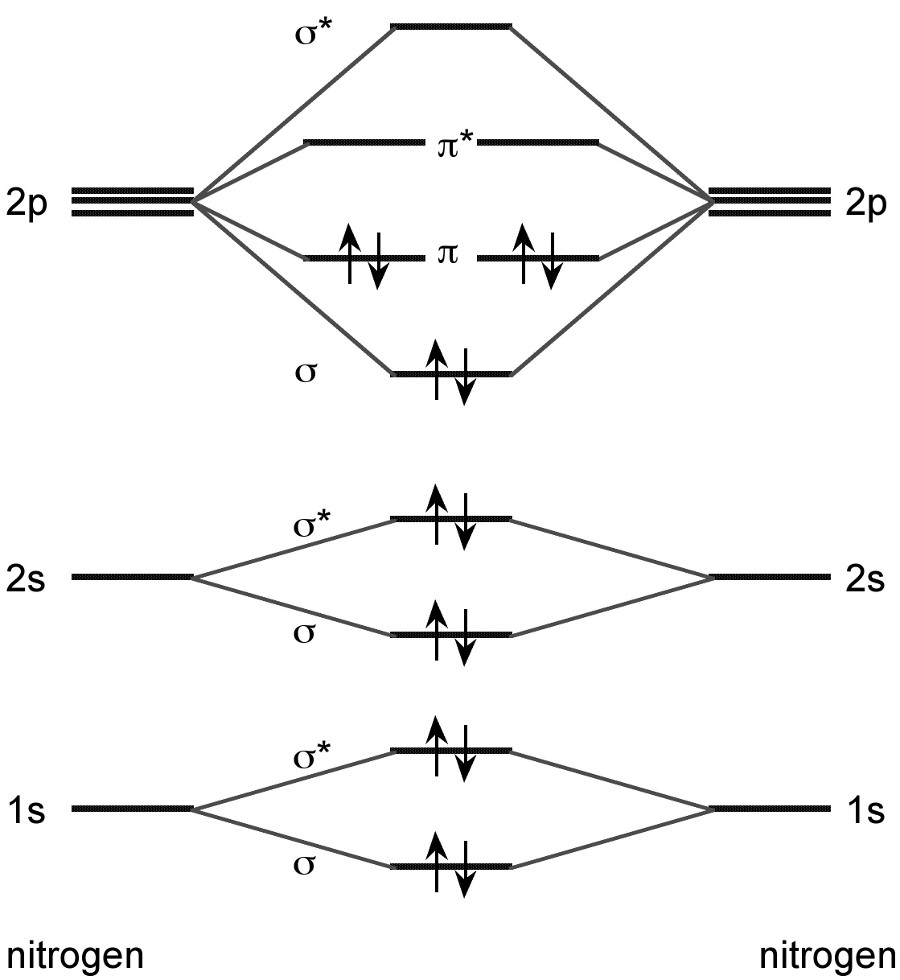

1s core-ionization of N2 by TD-DFT
==================================

Introduction
------------

We want to study the excitation of a 1s electron of the :math:`N_2` molecule to an empty orbital.
More precisely we shall look at the excitation of an electron from the bonding 
:math:`1s\sigma_g` or anti-bonding :math:`1s\sigma_u` -orbitals to the vacant :math:`2p\pi_g` or :math:`2p\sigma_u` orbitals (see MO-diagram below). 

Note that this diagram does not take spin-orbit into account, but we shall consider
this interaction later on. Let us first consider the possible final states. 
One electron leaves from one of four spin-orbitals and enters one of six spin-orbitals.
This gives 24 determinants which translates into the following states:

+-----------------------------------+------------------------+
| Configuration                     | States                 |
+===================================+========================+
| :math:`1s\sigma_g^{-1}2p\pi_g`    | :math:`^{1,3}\Pi_g`    |
+-----------------------------------+------------------------+
| :math:`1s\sigma_g^{-1}2p\sigma_u` | :math:`^{1,3}\Sigma_u` |
+-----------------------------------+------------------------+
| :math:`1s\sigma_u^{-1}2p\pi_g`    | :math:`^{1,3}\Pi_u`    |
+-----------------------------------+------------------------+
| :math:`1s\sigma_u^{-1}2p\sigma_u` | :math:`^{1,3}\Sigma_g` |
+-----------------------------------+------------------------+

Spin-orbit free calculation
---------------------------

We employ the following molecular input file `N2.mol` ::

  DIRAC
  N2  
  cc-pVTZ basis
  C   1              A
          7.    2
  N1         0.0        0.0       0.00000
  N2         0.0        0.0       1.09800
  LARGE BASIS cc-pVTZ
  FINISH                                                                                   

Here we do not provide any symmetry information, meaning that we ask DIRAC to detect it.
DIRAC will find that the full group is :math:`D_{\infty h}`. With spin-orbit coupling DIRAC
will then activate linear supersymmetry, but in the spin-orbit free case it will simply use
the highest Abelian single point group, that is :math:`D_{2h}`. For the final states DIRAC
will  employ the *total* symmetry, that is the combined spin and spatial symmetry.
Here we shall keep in mind that the singlet spin function is totally symmetric (:math:`A_g`), whereas the
triplet spin functions transform as rotations. We know the triplet functions as:

.. math::

   T_{-1} = \alpha_1\alpha_2;\quad T_0=\frac{1}{\sqrt{2}}\left(\alpha_1\beta_2-\beta_1\alpha_2\right);\quad T_{+1}=\beta_1\beta_2

but for our purposes it will be more convenient to form the combinations:

.. math::

   T_x=\frac{1}{\sqrt{2}}\left(T_{-1}-T_{+1}\right);\quad T_y=\frac{i}{\sqrt{2}}\left(T_{-1}+T_{+1}\right);\quad T_z=T_0

which transform as rotations :math:`R_x\left(B_{3g}\right)` , :math:`R_y\left(B_{2g}\right)` and :math:`R_z\left(B_{1g}\right)` , respectively. 

We can now set up the following correlation of states:

.. math::

+------------------------+--------------------------------+------------------------+----------------------------------------------------------------------------+  
| State                  | Spin                           | Spatial                | Spin :math:`\otimes` Spatial                                               |
+========================+================================+========================+============================================================================+  
|  :math:`^1\Sigma_g`    | :math:`A_g`                    | :math:`A_g`            | :math:`A_g`                                                                |
+------------------------+--------------------------------+------------------------+----------------------------------------------------------------------------+  
|  :math:`^1\Sigma_u`    | :math:`A_g`                    | :math:`B_{1u}`         | :math:`B_{1u}`                                                             |
+------------------------+--------------------------------+------------------------+----------------------------------------------------------------------------+  
|  :math:`^1\Pi_{x,y;g}` | :math:`A_g`                    | :math:`B_{3g}, B_{2g}` | :math:`B_{3g}, B_{2g}`                                                     |
+------------------------+--------------------------------+------------------------+----------------------------------------------------------------------------+  
|  :math:`^1\Pi_{x,y;u}` | :math:`A_g`                    | :math:`B_{3u}, B_{2u}` | :math:`B_{3u}, B_{2u}`                                                     |
+------------------------+--------------------------------+------------------------+----------------------------------------------------------------------------+  
|  :math:`^3\Sigma_g`    | :math:`B_{3g}, B_{2g}, B_{1g}` | :math:`A_g`            | :math:`B_{3g}, B_{2g}, B_{1g}`                                             |
+------------------------+--------------------------------+------------------------+----------------------------------------------------------------------------+  
|  :math:`^1\Sigma_u`    | :math:`B_{3g}, B_{2g}, B_{1g}` | :math:`B_{1u}`         | :math:`B_{2u}, B_{3u}, A_{u}`                                              |
+------------------------+--------------------------------+------------------------+----------------------------------------------------------------------------+  
|  :math:`^1\Pi_{x,y;g}` | :math:`B_{3g}, B_{2g}, B_{1g}` | :math:`B_{3g}, B_{2g}` | :math:`\left(A_g, B_{1g}, B_{2g}\right), \left(B_{1g}, A_g, B_{3g}\right)` |
+------------------------+--------------------------------+------------------------+----------------------------------------------------------------------------+  
|  :math:`^1\Pi_{x,y;u}` | :math:`B_{3g}, B_{2g}, B_{1g}` | :math:`B_{3u}, B_{2u}` | :math:`\left(A_u, B_{1u}, B_{2u}\right), \left(B_{1u}, A_u, B_{3u}\right)` |
+------------------------+--------------------------------+------------------------+----------------------------------------------------------------------------+  

Counting total symmetries we find the 24 microstates are evenly distributed amongst the eight irreps of :math:`D_{2h}`.

