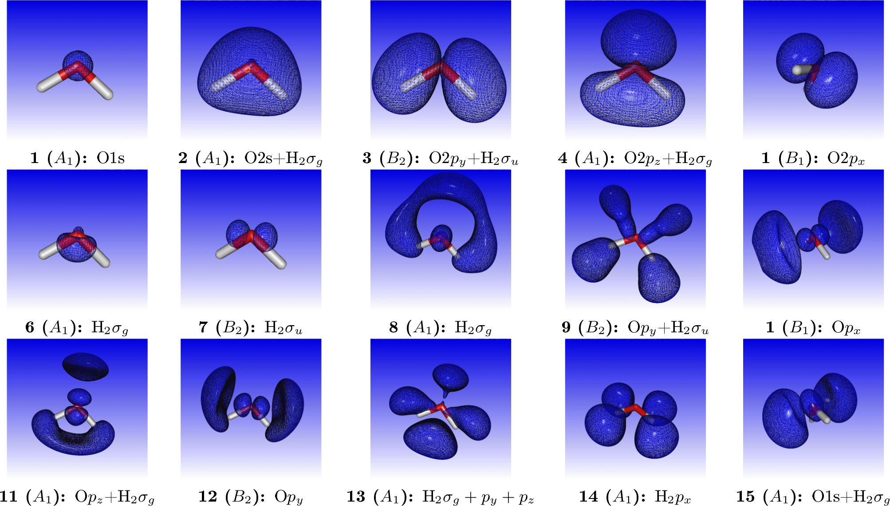

O1s core-ionization of H2O by complex response
==============================================

Introduction
------------

We want to study excitation of the oxygen 1s electron of water.

Excitation-window restricted TD-HF
----------------------------------

Starting from the molecular input file `H2O.mol` 

.. literalinclude:: H2O.mol

and the menu file `H2O.inp` 

.. literalinclude:: H2O.inp

we first run a Hartree-Fock calculation of the ground electronic state::

   pam --mol=H2O --inp=H2O --outcmo

From Mulliken population analysis we confirm that the oxygen 1s orbital is the first orbital::

   * Electronic eigenvalue no.  1: -20.581089118212       (Occupation : f = 1.0000)           
   ==========================================================================================
   
   * Gross populations greater than 0.00010
   
   Gross     Total   |    L A1 O  s   
   --------------------------------------
    alpha    1.0000  |      1.0000
    beta     0.0000  |      0.0000

We now focus on electric dipole allowed transitions. The molecular symmetry is :math:`C_{2v}` where the components of the 
electric dipole operator :math:`-e(x,y,z)` span irreps :math:`(B_1,B_2,A_1)`. This leads us
to set up the following input

.. literalinclude:: H2O_O1s.inp

We run our calculation::

   pam --inp=H2O_O1s --mol=H2O --incmo

and find the isotropically averaged oscillator strenghts

.. literalinclude:: H2O_1s_spectrum

where we have added by hand the most important virtual orbitals. 
For reference, orbital densities of the fifteen first canonical HF orbitals of water are given below

We may simulating the spectrum using a Lorentzian lineshape with half-width at half-maximum (HWHM) equal to 0.005 a.u.

.. image:: water_O1s_tdhf.png
   :scale: 100
   :alt: alternate text

Complex response
----------------

We can alternatively obtain the above spectrum from complex response. The isotropically averaged 
ocillator strength associated within the electric dipole approximation is related to the 
isotropic electric dipole polarizability through the relation

.. math::

   f^{iso}\left(\omega\right)=\frac{2m\omega}{\pi e^2} Im\left[\alpha^{iso}\left(\omega+i\gamma\right)\right]

where :math:`\gamma` is a damping parameter corresponding to the half-width at half-maximum (HWHM) of 
the Lorentzian lineshape.

We can calculate the real and imaginary parts of the polarizability by complex response. By choosing a 
frequency window we can directly access the region of the spectrum of interest.

Using the input file

.. literalinclude:: cpp.inp

and the command::

   pam --incmo --mol=H2O --inp=cpp

To get enough data points we do a second run using::

   .FREQ INTERVAL
   20.01 21.0 0.02

