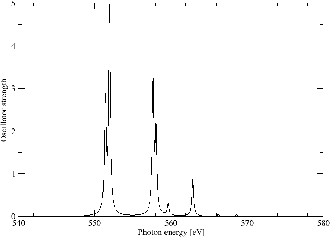

O1s core-ionization of H2O by complex response
==============================================

Introduction
------------

We want to study excitation of the oxygen 1s electron of water.
Starting from the molecular input file `H2O.mol` 

.. literalinclude:: H2O.mol

and the menu file `H2O.inp` 

.. literalinclude:: H2O.inp

we first run a Hartree-Fock calculation of the ground electronic state::

   pam --mol=H2O --inp=H2O --outcmo

From Mulliken population analysis we confirm that the oxygen 1s orbital is the first orbital::

   * Electronic eigenvalue no.  1: -20.581089118212       (Occupation : f = 1.0000)           
   ==========================================================================================
   
   * Gross populations greater than 0.00010
   
   Gross     Total   |    L A1 O  s   
   --------------------------------------
    alpha    1.0000  |      1.0000
    beta     0.0000  |      0.0000

We now focus on electric dipole allowed transitions. The molecular symmetry is :math:`C_{2v}` where the components of the 
electric dipole operator :math:`-e(x,y,z)` span irreps :math:`(B_1,B_2,A_1)`. This leads us
to set up the following input

.. literalinclude:: H2O_O1s.inp

We run our calculation::

   pam --inp=H2O_O1s --mol=H2O --incmo

and find the isotropically averaged oscillator strenghts::

   * ISOTROPIC DL-DL OSCILLATOR STRENGTHS (f)
   ==========================================
   DL = dipole length
   Rate = Dipole radiation rate (s-1)
   Lifetime = corresponding radiation lifetime (s)
   
   Level     Frequency     f             Rate           Lifetime
   ------------------------------------------------------------------------
       2    20.1880843814  0.00000002    0.20483E+06    0.48822E-05       
       3    20.1880853618  0.00000012    0.16192E+07    0.61758E-06       
       4    20.2106058884  0.00000020    0.26305E+07    0.38016E-06       
       6    20.2637822952  0.04094463    0.54019E+12    0.18512E-11       
       7    20.2840331058  0.07566515    0.10003E+13    0.99973E-12       
       9    20.4453126149  0.00000002    0.28737E+06    0.34799E-05       
      10    20.4725521853  0.00000026    0.35482E+07    0.28184E-06       
      12    20.4935960507  0.04949243    0.66786E+12    0.14973E-11       
      13    20.5086683295  0.03037128    0.41044E+12    0.24364E-11       
      14    20.5624885103  0.00000003    0.44279E+06    0.22584E-05       
      15    20.5624885107  0.00000002    0.33427E+06    0.29916E-05       
      16    20.5662290804  0.00436872    0.59371E+11    0.16843E-10       
      17    20.5701122256  0.00000001    0.13954E+06    0.71663E-05       
      18    20.5701122415  0.00000005    0.64527E+06    0.15497E-05       
      19    20.5851294613  0.00000477    0.64894E+08    0.15410E-07       
      22    20.6853090865  0.01353373    0.18606E+12    0.53746E-11       
      25    20.8084949905  0.00056602    0.78746E+10    0.12699E-09       
      31    20.8954525590  0.00057906    0.81233E+10    0.12310E-09       
    ------------------------------------------------------------------------
    Sum of oscillator strenghts:      0.21553

We may simulating the spectrum using a Lorentzian lineshape with half-width at half-maximum (HWHM) equal to 0.005 a.u.

