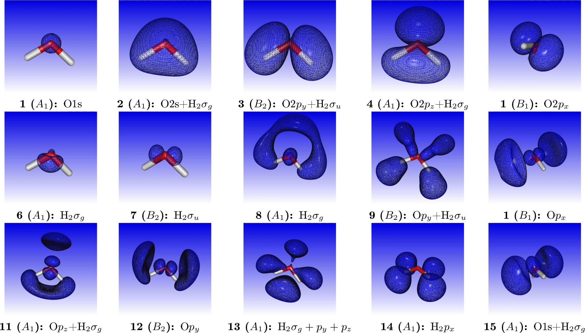
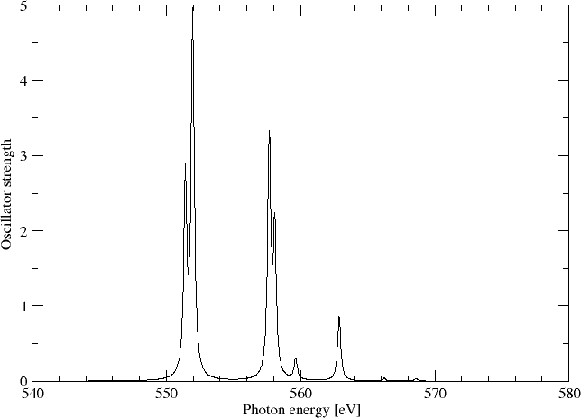
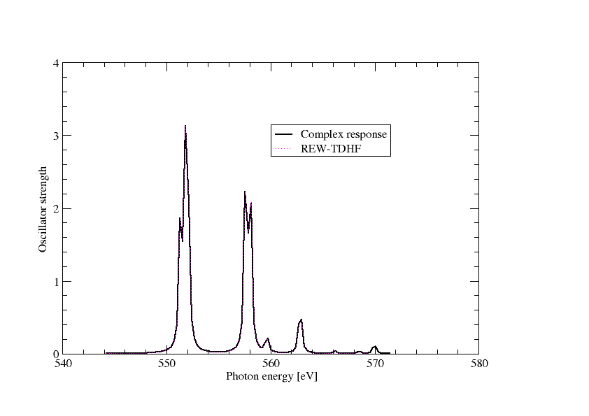
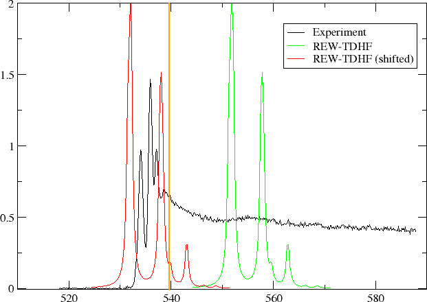
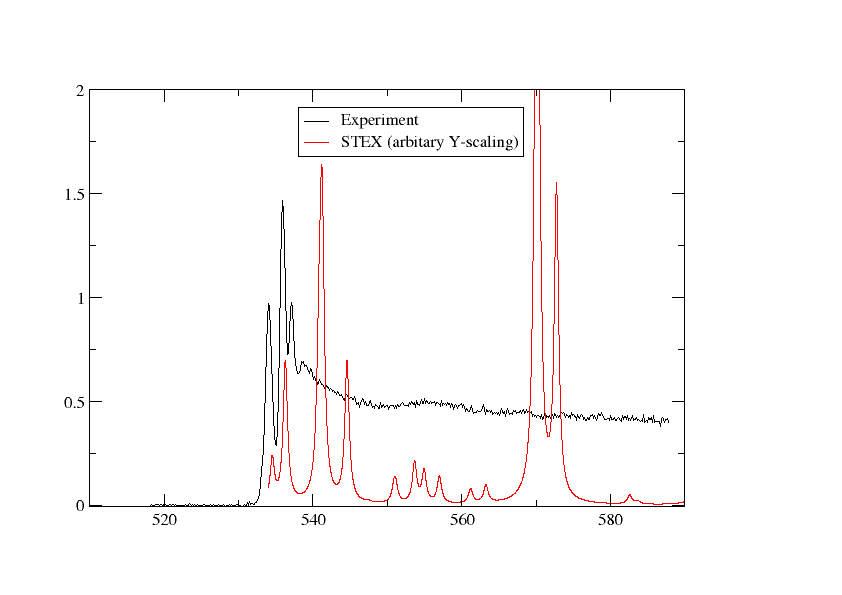

O1s core-ionization of H2O by complex response
==============================================

Introduction
------------

We want to study excitation of the oxygen 1s electron of water.

Restricted excitation window TD-HF (REW-TD-HF)
----------------------------------------------

Starting from the molecular input file `H2O.mol` 

.. literalinclude:: H2O.mol

and the menu file `H2O.inp` 

.. literalinclude:: H2O.inp

we first run a Hartree-Fock calculation of the ground electronic state::

   pam --mol=H2O --inp=H2O --outcmo

From Mulliken population analysis we confirm that the oxygen 1s orbital is the first orbital::

   * Electronic eigenvalue no.  1: -20.581089118212       (Occupation : f = 1.0000)           
   ==========================================================================================
   
   * Gross populations greater than 0.00010
   
   Gross     Total   |    L A1 O  s   
   --------------------------------------
    alpha    1.0000  |      1.0000
    beta     0.0000  |      0.0000

We now focus on electric dipole allowed transitions. The molecular symmetry is :math:`C_{2v}` where the components of the 
electric dipole operator :math:`-e(x,y,z)` span irreps :math:`(B_1,B_2,A_1)`. This leads us
to set up the following input

.. literalinclude:: H2O_O1s.inp

We run our calculation::

   pam --inp=H2O_O1s --mol=H2O --incmo

and find the isotropically averaged oscillator strenghts

.. literalinclude:: H2O_1s_spectrum

where we have added by hand the most important virtual orbitals. 
For reference, orbital densities of the fifteen first canonical HF orbitals of water are given below

We may simulating the spectrum using a Lorentzian lineshape with half-width at half-maximum (HWHM) equal to 0.005 a.u.

Complex response
----------------

We can alternatively obtain the above spectrum from complex response. The isotropically averaged 
ocillator strength associated within the electric dipole approximation is related to the 
isotropic electric dipole polarizability through the relation

.. math::

   f^{iso}\left(\omega\right)=\frac{2m\omega}{\pi e^2} Im\left[\alpha^{iso}\left(\omega+i\gamma\right)\right]

where :math:`\gamma` is a damping parameter corresponding to the half-width at half-maximum (HWHM) of 
the Lorentzian lineshape.

We can calculate the real and imaginary parts of the polarizability by complex response. By choosing a 
frequency window we can directly access the region of the spectrum of interest.

We use the input file

.. literalinclude:: cpp.inp

and the command::

   pam --incmo --mol=H2O --inp=cpp

To get enough data points we do a second run using::

   .FREQ INTERVAL
   20.01 21.0 0.02

Extracting the imaginary part of the frequency-dependent electric dipole polarizatibility and converting to oscillator strength 
we can directly plot the spectrum as below

In the above graph we have also included the results from REW-TDDFT and they completely overlap, except that a keen eyemay note that 
REW-TDDFT is missing the peak around 570 eV, simply because not enough excitations were specified in the input.

Localizing the K edge
---------------------

An interesting question is how to localize the K edge in the XANES spectrum.
A first approximation to the 1s ionization energy is provided by Koopman's 
theorem. We find :math:`IP_{1s}\approx -\varepsilon_{1s} =` 560.04 eV.
This is singificantly off the value 539.7 eV reported by Kai Siegbahn and co-workers
[*ESCA applied to free molecules*(1969)] ( see also `here <http://srdata.nist.gov/xps/XPSDetailPage.aspx?AllDataNo=21090>`_ ,
but here the work function of the reference metal must be subtracted).
reported by Kai Siegbahn and co-workers in 1977. We know that Koopman's theorem ignores correlation and 
orbital relaxation. For valence ionization Koopman's theorem often provides a reasonable approximation 
since the errors tend to cancel each other. For core excitations orbital relaxation dominates such that 
Koopman's theorem greatly overestimates ionization energies. 

To see this we carry our a average-of-configuration (AOC) calculation of the 1s core-ionized system. 
Starting from the coefficients from the neutral system and the input

.. literalinclude:: H2O_1s.inp

we find a total energy of -56.287847 :math:`E_h` for the core ionized system compared to 
-76.115149 :math:`E_h` for the neutral system. This corresponds to a :math:`\Delta` SCF value 
of 539.52 eV for the ionization energy, tantalizingly close to experiment.

However this K edge does not correspond to that of our TD-HF or complex reponse calculations since they 
only allow linear reponse (orbital relaxation). To get an idea of the ionization energy at the linear 
reponse level we place a tight s exponent on a ghost center far from out water molecule

.. literalinclude:: H2Ogh.mol

We then again calculate the water molecule::

   pam --inp=H2O --mol=H2Ogh --outcmo

and find the eigenvalue corresponding to our ghost function::

   * Electronic eigenvalue no. 72:  1444.4471138822       (Occupation : f = 0.0000)           
   ==========================================================================================
   
   * Gross populations greater than 0.00010
   
   Gross     Total   |    L A1 Gh s   
   --------------------------------------
    alpha    1.0000  |      1.0000
    beta     0.0000  |      0.0000

We now force an excitation from the neutral water molecule to the remote ghost function using the input file 

.. literalinclude:: ghost.inp

Here we have specified one excitation in each symmetry: The totally symmetric (:math:`A_1`) excitation 
corresponds to the singlet excitation, whereas the other three encompass the triplet excitations.
We run the TD-HF calculation::

   pam --inp=ost --mol=H2Ogh --incmo

and find in the output::

    Energy eigenvalues in atomic units
   
    Level   Rel eigenvalue     Abs eigenvalue      Total Energy    Degeneracy
    
        0     0.0000000000      0.000000000000      -76.115149331848 (   1 * )
        1  1465.0082924354   1465.008292435403     1388.893143103555 (   4 * )

Subtracting off the ghost orbital eigenvalue from the excitation energy we obtain 559.50 eV, very 
close to the Koopman's theorem value.

In the figure below we have plotted oscillator strength per atom for 1s core excitation spectrum for
water, taken from the `Gas Phase Core Excitation Database <http://unicorn.mcmaster.ca/corex/cedb-title.html>`_ 
and recorded at 0.7 eV fwhm.

The vertical orange line corresponds to the O1s binding energy reported by Siegbahn and co-workers and 
seems to be too early. We have also plotted the spectrum obtained by REW-TDHF with a Lorentzian wideshape 
corresponding to the fwhm of the experiment. In green we plot the original spectrum, whereas in red it has 
been shifted so that our linear response estimate for the ionization energy has been aligned with the 
experimental O1s binding energy. We can see that the shift improves agreement, but
the spacing and relative intensities of peaks do not agree with experiment.

Static Exchange Approximation
-----------------------------

In order to incorporate orbital relaxation we carry out a STEX calculation.
At the moment symmetry is not implemented, so we turn off symmetry in the nolecular input file

.. literalinclude:: H2O_C1.mol

We then first run the ground state::

   pam --inp=H2O --mol=H2O_C1 --outcmo

followed by the 1s core-ionized state::

   pam --mol=H2O_C1 --inp=H2O_1s --incmo --get "DFCOEF=DFCOEF.ION"

We now run STEX using the input

.. literalinclude:: stex.inp

We have plotted the STEX spectrum below together with the experimental one

