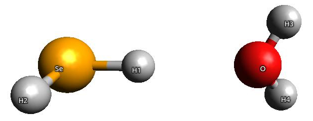

:orphan:

.. _FDENMR:

================================================================
Calculation of NMR shieldings in Frozen Density Embedding scheme
================================================================

In this tutorial we look at calculations of NMR shielding tensor with London atomic orbitals
within the FDE scheme. 

Basic theory of NMR-LAO with FDE
================================

In order to calculate the NMR properties with LAOs, one must take into account 
modifications of the property gradient due to the use of perturbation-dependent basis sets.
Here we only present some key points, for the detailed explanations we encourage the reader
to consults papers...
The FDE contribution to the property gradient due to the use of perturbation-dependent basis sets:

.. math::

    E_{[1],emb}^{[B]} = - \int v_{emb}^I \Omega_{ia}^{B,I} - \iint w_{emb}^{I,I} \Omega_{ia}^{I} \Omega_{jj}^{I} - \iint w_{emb}^{I,II} \Omega_{ia}^{I} \Omega_{jj}^{II}

where :math:`\Omega_{pq}^{B}` is the first-order perturbed overlap distribution, which in a basis of London orbitals consists of two terms

.. math::

    \Omega_{pq}^{B} = \frac{i}{2} (R_{MN} \times r) \Omega_{pq} + (T_{pt}^{B*} \Omega_{tq} + \Omega_{pt}T_{tq}^B)

"direct" LAO term (the first term) and "reorthonormalization" term (two last terms in brackets).

In this tutorial we will show how to include each of the contributions to the property gradient in the
calculations of the NMR shielding tensor. We will also present how to calculate and plot the first-order
perturbed current density induced by magnetic field and how to use it in analysis of the NMR shielding tensor.

A sample calculation of NMR shielding tensor within FDE
=======================================================

We will consider a simple system of SeH\ :sub:`2`\ - H\ :sub:`2`\ O, in which SeH\ :sub:`2`\ 
constitutes an active subsystem (subsystem I) and H\ :sub:`2`\ O\ is an environment (subsystem II):

 
The computational protocol is different depending on whether the coupling between two
subsystems is included or not (through the term dependent on :math:`w_{emb}^{I,II}`).
To avoid confusion, we will describe these two protocols separately.

We will need two molecular input files. File ``h2se.mol``, corresponding to an active subsystem I, reads:

.. literalinclude:: h2se.mol

and file ``h2o.mol``, standing for an environment subsystem II:

.. literalinclude:: h2o.mol

Calculations without the FDE coupling terms
-------------------------------------------

We will show how to include only the first two terms in the property gradient.

Before launching any calculations, one should think of the numerical grid that will be used
for the system. In this tutorial, we use a coarse grid generated in DIRAC in preceeding calculations
on SeH\ :sub:`2`\ - H\ :sub:`2`\ O supermolecule.
In this case, the numerical grid was exported on a ``numerical_grid`` file which is divided into 
batches of points. However, FDE module is able to read only the continuous list of grid points,
therefore such ``numerical_grid`` file has to be reformatted.
This can be done by the script, which can be found in ``utils`` directory of DIRAC:
``dft_to_fde_grid_convert.py``, which should be used on a ``numerical_grid`` file exported from DIRAC:

.. literalinclude:: grid_convert

The original grid file is saved as ``numerical_grid.ORIG``

Step 1: SCF calculation on the subsystem II
~~~~~~~~~~~~~~~~~~~~~~~~~~~~~~~~~~~~~~~~~~~

The first step is the calculation on subsystem II, the aim of which is
to get its density and electrostatic potential written on a text file.

The menu file ``getfrozen.inp`` reads:

.. literalinclude:: getfrozen.inp

and we make sure to recover the text file related to the :ref:`GRIDOU` keyword, which we name ``GRIDOUT``.
We should also remember to supply two files, 
related to keywords :ref:`GRIDOU` (``GRIDOUT``) and :ref:`EXONLY` (``FILEEX``),
which are copies of a numerical grid file

.. literalinclude:: getfrozen.run

After this calculation, the ``GRIDOUT`` file will be updated: additional columns on that file
correspond to the electrostatic potential and the density of subsystem II
calculated in each of grid points on that file.

Step 2: SCF and response calculation on the subsystem I
~~~~~~~~~~~~~~~~~~~~~~~~~~~~~~~~~~~~~~~~~~~~~~~~~~~~~~~

Now we can use the information on the subsystem II written on the ``GRIDOUT`` file for constructing
the embedding potential, :math:`v_{emb}^{I}`, and embedding kernel, :math:`w_{emb}^{I,I}`.
In order to do that, we use the ``GRIDOUT`` file saved from Step 1 and copy it to a ``FROZEN`` file,
given as an argument to the :ref:`FRDENS` keyword.

To simplify this tutorial, we will do the SCF step and response calculations in one run, by using the following input file:

.. literalinclude:: updatefrozen_v.inp

and the ``pam`` command is:

.. literalinclude:: updatefrozen_v.run

As we used the keyword :ref:`LAODPT`, the property gradient will contain the contribution
from the embedding potential, :math:`v_{emb}^{I}`.
In order to include also contributions from the embedding kernel, :math:`w_{emb}^{I,I}`, 
we should use two additional keywords in the :ref:`*FDE` Section:

.. literalinclude:: updatefrozen_v_w11.inp

with the ``pam`` command:

.. literalinclude:: updatefrozen_v_w11.inp

Calculations with the FDE coupling terms
----------------------------------------

We will show how to include the coupling between two subsystems in the property gradient 
(term dependent on :math:`w_{emb}^{I,II}`).

Step 1: SCF and response calculation on the subsystem II
~~~~~~~~~~~~~~~~~~~~~~~~~~~~~~~~~~~~~~~~~~~~~~~~~~~~~~~~

The first step is the calculation on subsystem II, the aim of which is
to get its density and electrostatic potential written on a text file.
In addition, we will export the perturbed density of subsystem II

The menu file ``getfrozenpert.inp`` reads:

.. literalinclude:: getfrozenpert.inp

...TODO gosia

Magnetically-induced current density and property densities within FDE
======================================================================

The tutorial on visualization methods in DIRAC is available on this website (add link).
Therefore here we will only show how to apply these mehods to an analysis of the magnetically-induced current
density and the NMR shielding density (theory described in :cite:`Bast2009vis`) calculated within FDE.

As described in the visualization tutorial, in order to calculate and visualize the magnetically induced current
density and related properties, one should start with SCF and response calculations (in steps presented above).
The only change is to retrieve appropriate files from the final response 
calculations on an active subsystem: ``PAMXVC``, ``TBMO`` and ``DFCOEF``.
The ``pam`` command used in response calculations should then be following:

.. literalinclude:: response_vis.run

Next step is choosing one component of magnetic field as a perturbation and identifying the corresponding response vectors
on the ``PAMXVC`` file, by using the following command:

.. literalinclude:: pamxvc_cmd

where ``rspread.x`` executable can be found in the DIRAC's ``build`` directory.

Below we will show an examplary input prepared to calculate the perturbed current density induced by the ``y``-component 
of an external magnetic field, with London atomic orbitals:

.. literalinclude:: vis_j.inp

where the perturbed current density will be plotted in a plane of SeH2 molecule
(for full list of possibilities see :ref:`**VISUAL` and the VISUAL - tutorial).
And the corresponding ``pam`` command:

.. literalinclude:: vis_j.run

From this calculation, we retrieve files ``plot.*``, which can be visualized in any plotting software.

Analogously, plots of the NMR shielding density can be done. For instance, in order to plot the ``xx``-component
of the NMR shielding tensor of Se atom, one could use the following input:

.. literalinclude:: vis_shield_xx_se.inp

with the corresponding ``pam`` command:

.. literalinclude:: vis_shield_xx_se.run

The files ``plot.*`` should be saved for plotting.

These plots can be used in analysis of FDE contributions. For example, one can calculate the plot of an active subsystem
in three different settings: as an isolated system, with environment accounted for by FDE method and with environment
accounted for in a supermolecular way.
The scripts available in the DIRAC ``utils`` directory can be used to add and substract two plots.

Below, we show an examplary plots of a property in an isolated subsystem and two differential plots, calculated as
fde-isolated and supermolecule-isolated...
For a magnetically induced current density in SeH2 plane:

And for a NMR shielding density of Se atom:

The NMR shielding density integrated over all space equals to the value of the corresponding component of the NMR shielding
tensor. It is also possible to determine its value in any point in space, what is useful when calculating NICS values.
We may for instant try to determine the value of the ``xx``-component of the NMR shielding tensor of Se atom in place
of H atom from H2O molecule

Tips:
-----
- The grid for 3d plot is generated specifically for a molecular system. Therefore in order to add or substract two plots, the
 user should pay attention to do so on the same grids. For example, in order to do the differential plot of a property density between the supermolecule and the isolated subsystem, the easiest is to add ghost atoms to the latter corresponding to an environment, which is present in a supermolecular case.

