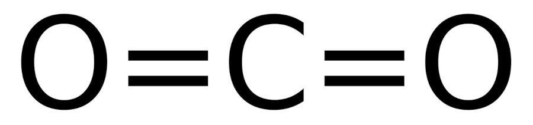

:orphan:
 

========================
Localization of orbitals
========================

-------------------------
Example 1: Carbon dioxide
-------------------------

Textbooks and other sources, e.g. `Wikipedia <https://en.wikipedia.org/wiki/Carbon_dioxide>`_ gives a Lewis structure of
carbon dioxide with double bond from carbon to each oxygen. Is this the correct bonding picture ?

To investigate this, we shall carry out Pipek-Mezey localization :cite:`Pipek:Mezey` of the canonical molecular orbitals of carbon dioxide. We start from the molecular input *CO2.xyz*

.. literalinclude:: CO2.xyz

as well as the menu file *CO2.inp*

.. literalinclude:: CO2.inp

Note that we distinguish the two oxygen atoms. Since we do not use the proper element name, the approprirate charges are given in the
menu file using the NUCLEUS keyword. We run the SCF calculation using::

  pam --inp=CO2 --mol=CO2.xyz

In preparation for localization we used the keyword :ref:`GENERAL_.ACMOUT` to dump :math:`C_1` - coefficients to the checkpoint file. You can
check this using::

  h5dump -n CO2.h5 | grep C1
   dataset    /result/wavefunctions/scf/mobasis/eigenvalues_C1
   dataset    /result/wavefunctions/scf/mobasis/orbitals_C1

Now we are ready to localize the canonical MOs. We use the menu file *loc.inp*

.. literalinclude :: loc.inp

Note that we now have turned off symmetry (NOSYM) and ask to read the :math:`C_1` coeffcients from the checkpoint file using
the :ref:`GENERAL_.ACMOIN` keyword. We run localization using::

  pam --inp=loc --mol=CO2.xyz --put "CO2.h5=DFACMO.h5"

Using grep we find::

 $grep '*C' loc_CO2.out
  *CENTERS                                                                                            
  *C   ITR    DIFFA      |GRAD|     |KAPPA|  H(nonD/D)    e: +,-,0         H      DIFFG      DIFFQ      HMIN
  *C     0   0.00D+00   0.15D-01   0.00D+00   0.00115    158    54     8   FULL   0.00D+00   0.00D+00  -0.36D+00
  *C     1   0.21D-01   0.86D-02   0.54D+01   0.00068    183    29     8   FULL  -0.21D-01  -0.22D+01  -0.36D+00
  *C     2   0.57D-02   0.78D-02   0.34D+00   0.00037    184    28     8   FULL  -0.57D-02  -0.72D-02  -0.36D+00
  *C     3   0.13D-02   0.53D-02   0.59D+00   0.00035    193    19     8   FULL  -0.13D-02  -0.33D-02  -0.37D+00
  *C     4   0.88D-03   0.99D-03   0.26D+00   0.00021    199    13     8   FULL  -0.88D-03  -0.10D-02  -0.37D+00
  *C     5   0.27D-04   0.32D-04   0.49D+00   0.00010    204     8     8   FULL  -0.27D-04  -0.27D-04  -0.37D+00
  *C     6   0.14D-07   0.28D-07   0.40D-01   0.00008    204     8     8   FULL  -0.14D-07  -0.14D-07  -0.37D+00
  *C     7   0.98D-01   0.81D-01   0.67D+00   0.00143    203     9     8   FULL  -0.98D-01  -0.17D+00  -0.26D+00
  *C     8   0.54D-01   0.89D-01   0.30D+00   0.00130    201    11     8   FULL  -0.54D-01  -0.64D-01  -0.18D+00
  *C     9   0.23D-01   0.52D-01   0.16D+00   0.00116    201    11     8   FULL  -0.23D-01  -0.25D-01  -0.18D+00
  *C    10   0.78D-02   0.65D-02   0.17D+00   0.00103    203     9     8   FULL  -0.78D-02  -0.86D-02  -0.18D+00
  *C    11   0.42D-04   0.50D-02   0.40D+01   0.00104    205     7     8   FULL  -0.42D-04  -0.10D-03  -0.18D+00
  *C    12   0.68D-04   0.73D-04   0.59D+00   0.00104    208     4     8   FULL  -0.68D-04  -0.70D-04  -0.18D+00
  *C    13   0.64D-06   0.73D-05   0.39D+00   0.00103    208     4     8   FULL  -0.64D-06  -0.16D-05  -0.18D+00
  *C    14   0.39D-06   0.74D-06   0.13D+00   0.00104    208     4     8   FULL  -0.39D-06  -0.41D-06  -0.18D+00
  *C    15   0.28D-08   0.41D-08   0.10D-01   0.00103    208     4     8   FULL  -0.28D-08  -0.28D-08  -0.18D+00
  *C    16   0.25D-01   0.73D-02   0.40D+01   0.00101    206     6     8   FULL  -0.25D-01  -0.16D+01  -0.18D+00
  *C    17   0.42D-03   0.12D-03   0.62D-01   0.00100    209     3     8   FULL  -0.42D-03  -0.42D-03  -0.18D+00
  *C    18   0.13D-06   0.10D-07   0.50D-02   0.00100    209     3     8   FULL  -0.13D-06  -0.13D-06  -0.18D+00
  *C    19   0.58D-05   0.32D-04   0.10D+01   0.00099    210     2     8   FULL  -0.58D-05  -0.28D-04  -0.18D+00
  *C    20   0.11D-01   0.41D-01   0.25D+00   0.00100    202    16     2   FULL  -0.11D-01  -0.11D-01  -0.14D+00
  *C    21   0.79D-01   0.70D-02   0.82D+00   0.00033    212     6     2   FULL  -0.79D-01  -0.16D+00  -0.11D-03
  *C    22   0.27D-03   0.28D-04   0.28D+00   0.00033    212     6     2   FULL  -0.27D-03  -0.27D-03  -0.18D-08
  *C    23   0.14D-06   0.25D-06   0.72D-01   0.00033    212     0     8   FULL  -0.14D-06  -0.14D-06   0.00D+00

Let us now have a look at the localized orbitals. The Pipek-Mezey criterion minimizes the number of centers spanned by each MO.
We accordingly perform a Mulliken population analysis, asking only for the distribution of density amongst the three atoms.
The menu file *atompop.inp* reads

.. literalinclude :: atompop.inp

We run the calculation using::

  pam --inp=atompop --mol=CO2.xyz --put "loc_CO2.h5=CHECKPOINT.h5"

In the output we find::

      **************************************************************************
      ********************** Mulliken population analysis **********************
      **************************************************************************
  
  
  
                                   Fermion ircop E1
                                   ----------------
  
  
  * Electronic eigenvalue no.   1: -19.228904376854       (Occupation : f = 1.0000)           
  ============================================================================================
  
  * Gross populations greater than 0.01000
  
  Gross     Total   |    L O1  1     
  --------------------------------------
   alpha    1.0000  |      1.0086
   beta     0.0000  |      0.0000
  
  * Electronic eigenvalue no.   2: -19.228897406456       (Occupation : f = 1.0000)           
  ============================================================================================
  
  * Gross populations greater than 0.01000
  
  Gross     Total   |    L O2  1     
  --------------------------------------
   alpha    1.0000  |      1.0086
   beta     0.0000  |      0.0000
  
  * Electronic eigenvalue no.   3: -10.375624527418       (Occupation : f = 1.0000)           
  ============================================================================================
  
  * Gross populations greater than 0.01000
  
  Gross     Total   |    L C   1     
  --------------------------------------
   alpha    0.9997  |      1.0010
   beta     0.0003  |      0.0000
  
  * Electronic eigenvalue no.   4: -1.1701747687870       (Occupation : f = 1.0000)           
  ============================================================================================
  
  * Gross populations greater than 0.01000
  
  Gross     Total   |    L O2  1     
  --------------------------------------
   alpha    0.9995  |      0.9988
   beta     0.0005  |      0.0000
  
  * Electronic eigenvalue no.   5: -1.1313373272171       (Occupation : f = 1.0000)           
  ============================================================================================
  
  * Gross populations greater than 0.01000
  
  Gross     Total   |    L C   1        L O1  1     
  -----------------------------------------------------
   alpha    1.0000  |      0.4569         0.5497
   beta     0.0000  |      0.0000         0.0000
  
  * Electronic eigenvalue no.   6: -0.5710187998784       (Occupation : f = 1.0000)           
  ============================================================================================
  
  * Gross populations greater than 0.01000
  
  Gross     Total   |    L C   1        L O2  1     
  -----------------------------------------------------
   alpha    1.0000  |      0.4569         0.5497
   beta     0.0000  |      0.0000         0.0000
  
  * Electronic eigenvalue no.   7: -0.5281308034633       (Occupation : f = 1.0000)           
  ============================================================================================
  
  * Gross populations greater than 0.01000
  
  Gross     Total   |    L O1  1     
  --------------------------------------
   alpha    0.9995  |      0.9988
   beta     0.0005  |      0.0000
  
  * Electronic eigenvalue no.   8: -0.5229733977076       (Occupation : f = 1.0000)           
  ============================================================================================
  
  * Gross populations greater than 0.01000
  
  Gross     Total   |    L C   1        L O1  1     
  -----------------------------------------------------
   alpha    1.0000  |      0.2282         0.7706
   beta     0.0000  |      0.0000         0.0000
  
  * Electronic eigenvalue no.   9: -0.5229733976932       (Occupation : f = 1.0000)           
  ============================================================================================
  
  * Gross populations greater than 0.01000
  
  Gross     Total   |    L C   1        L O1  1     
  -----------------------------------------------------
   alpha    1.0000  |      0.2282         0.7706
   beta     0.0000  |      0.0000         0.0000
  
  * Electronic eigenvalue no.  10: -0.3795760457099       (Occupation : f = 1.0000)           
  ============================================================================================
  
  * Gross populations greater than 0.01000
  
  Gross     Total   |    L C   1        L O2  1     
  -----------------------------------------------------
   alpha    1.0000  |      0.2282         0.7706
   beta     0.0000  |      0.0000         0.0000
  
  * Electronic eigenvalue no.  11: -0.3795760457064       (Occupation : f = 1.0000)           
  ============================================================================================
  
  * Gross populations greater than 0.01000
  
  Gross     Total   |    L C   1        L O2  1     
  -----------------------------------------------------
   alpha    1.0000  |      0.2282         0.7706
   beta     0.0000  |      0.0000         0.0000
  
  
  *** Total gross population ***
  
  Gross      Total    |    L C   1        L O1  1        L O2  1     
  --------------------------------------------------------------------
   total    22.00000  |      5.62427        8.18536        8.18536

Simple observation shows that there are *three* and not two localized orbitals connecting carbon to each oxygen atom, suggesting
*triple* and not double bonds. Before exploring this further, it is important to note that the orbitals energies given in the
output are those of the canonical MOs. Localized MOs do not have orbital energies. However, to establish some energetic ordering
we can calculate *approximate* orbital energies as expectation values of each localized orbital with respect to the Kohn-Sham 
matrix (for HF calculations one would use the Fock matrix).

Since we can not use molecular symmetry with the localized orbitals we first have to reconstruct the Kohn-Sham matrix for the :math:`C_1` case.
We prepare the input file *scf0.inp* 

.. literalinclude :: scf0.inp

Note that we set the number of SCF iterations to zero such that we only build the initial Kohn--Sham matrix with the input coefficients (no diagonalization). Next we run::

  pam --inp=scf0 --mol=CO2.xyz --put "loc_CO2.h5=CHECKPOINT.h5" --get DFFCKT

where we recover the total Kohn-Sham matrix in the unformatted file DFFCKT.
To see that our procedure actually works let us first calculate the expectation value of this matrix with respect to the original canonical MOs.
Using the input file *exp0.inp*

.. literalinclude :: expC.inp

we run::

  pam --inp=expC --mol=CO2.xyz --put "CO2.h5=DFACMO.h5 DFFCKT"

Note that we use the keyword :ref:`GENERAL_.ACMOIN` since want to use the :math:`C_1` coefficients from the original DFT calculation with symmetry. At the end of the generated output file we then find back the orbital energies that are found in the Mulliken population
analysis above::

                      Expectation value for individual orbitals
                      -----------------------------------------
  
  
                  Matrix element     Occ.  
      E1     1   -19.22890437800     2.0000     -38.45780875600
      E1     2   -19.22889740759     2.0000     -38.45779481518
      E1     3   -10.37562453182     2.0000     -20.75124906363
      E1     4   -1.170174770392     2.0000     -2.340349540785
      E1     5   -1.131337328982     2.0000     -2.262674657965
      E1     6   -0.571018800591     2.0000     -1.142037601183
      E1     7   -0.528130804300     2.0000     -1.056261608600
      E1     8   -0.522973398844     2.0000     -1.045946797688
      E1     9   -0.522973398844     2.0000     -1.045946797688
      E1    10   -0.379576046966     2.0000     -0.759152093933
      E1    11   -0.379576046966     2.0000     -0.759152093933
      -------------------------------------------------------------------------------------
      Total :                                   -108.0783738266 a.u.      s0 = F   t0 = F
      -------------------------------------------------------------------------------------
      s0 = T : Expectation value zero by point group symmetry.
      t0 = T : Expectation value zero by time reversal symmetry.

Now we do the same with the localized orbitals and combine this with a mode detailed Mulliken population analysis. We set up the input
file *exp.inp*

.. literalinclude :: exp.inp

and run::

  pam --inp=exp --mol=CO2.xyz --put "loc_CO2.h5=CHECKPOINT.h5 DFFCKT"

In the new Mulliken population analysis we still have the orbital energies of the canonical orbitals, but in
the output below I have replaced these with the expectation values for the localized orbitals and also reordered
the orbitals on energy. I have kept the original numbering, though. We now have::

   * Electronic eigenvalue no.   7: -17.16989574591       (Occupation : f = 1.0000)           
   ============================================================================================
   
   * Gross populations greater than 0.01000
   
   Gross     Total   |    L A  O1 s      L A  O1 pz  
   -----------------------------------------------------
    alpha    0.9995  |      0.9858         0.0130
    beta     0.0005  |      0.0000         0.0000
   
   * Electronic eigenvalue no.   4: -17.14806997582       (Occupation : f = 1.0000)           
   ============================================================================================
   
   * Gross populations greater than 0.01000
   
   Gross     Total   |    L A  O2 s      L A  O2 pz  
   -----------------------------------------------------
    alpha    0.9995  |      0.9856         0.0132
    beta     0.0005  |      0.0000         0.0000
   
   * Electronic eigenvalue no.   3: -10.33132604930       (Occupation : f = 1.0000)           
   ============================================================================================
   
   * Gross populations greater than 0.01000
   
   Gross     Total   |    L A  C  s   
   --------------------------------------
    alpha    0.9997  |      1.0010
    beta     0.0003  |      0.0000
   
   * Electronic eigenvalue no.   2: -2.821559678558       (Occupation : f = 1.0000)           
   ============================================================================================
   
   * Gross populations greater than 0.01000
   
   Gross     Total   |    L A  C  s      L A  O2 s      L A  O2 pz  
   --------------------------------------------------------------------
    alpha    1.0000  |     -0.0108         0.8393         0.1692
    beta     0.0000  |     -0.0000         0.0000         0.0000
   
   * Electronic eigenvalue no.   1: -2.799733777067       (Occupation : f = 1.0000)           
   ============================================================================================
   
   * Gross populations greater than 0.01000
   
   Gross     Total   |    L A  C  s      L A  O1 s      L A  O1 pz  
   --------------------------------------------------------------------
    alpha    1.0000  |     -0.0108         0.8391         0.1694
    beta     0.0000  |     -0.0000         0.0000         0.0000
   
   * Electronic eigenvalue no.   5: -0.981751468005       (Occupation : f = 1.0000)           
   ============================================================================================
   
   * Gross populations greater than 0.01000
   
   Gross     Total   |    L A  C  s      L A  C  pz     L A  C  dzz    L A  O1 s      L A  O1 pz     L A  O1 dzz 
   -----------------------------------------------------------------------------------------------------------------
    alpha    1.0000  |      0.2676         0.1794         0.0284         0.0792         0.4654         0.0133
    beta     0.0000  |      0.0000         0.0000         0.0000         0.0000         0.0000         0.0000
   
   
   * Electronic eigenvalue no.   6: -0.981751327023       (Occupation : f = 1.0000)           
   ============================================================================================
   
   * Gross populations greater than 0.01000
   
   Gross     Total   |    L A  C  s      L A  C  pz     L A  C  dzz    L A  O2 s      L A  O2 pz     L A  O2 dzz 
   -----------------------------------------------------------------------------------------------------------------
    alpha    1.0000  |      0.2676         0.1794         0.0284         0.0792         0.4654         0.0133
    beta     0.0000  |      0.0000         0.0000         0.0000         0.0000         0.0000         0.0000
   
   * Electronic eigenvalue no.   8: -0.451274722906       (Occupation : f = 1.0000)           
   ============================================================================================
   
   * Gross populations greater than 0.01000
   
   Gross     Total   |    L A  C  py     L A  C  dyz    L A  O1 py  
   --------------------------------------------------------------------
    alpha    1.0000  |      0.2034         0.0248         0.7677
    beta     0.0000  |      0.0000         0.0000         0.0000
   
   * Electronic eigenvalue no.   9: --0.451274722906       (Occupation : f = 1.0000)           
   ============================================================================================
   
   * Gross populations greater than 0.01000
   
   Gross     Total   |    L A  C  px     L A  C  dxz    L A  O1 px  
   --------------------------------------------------------------------
    alpha    1.0000  |      0.2034         0.0248         0.7677
    beta     0.0000  |      0.0000         0.0000         0.0000
   
   * Electronic eigenvalue no.  10: -0.451274722904       (Occupation : f = 1.0000)           
   ============================================================================================
   
   * Gross populations greater than 0.01000
   
   Gross     Total   |    L A  C  px     L A  C  dxz    L A  O2 px  
   --------------------------------------------------------------------
    alpha    1.0000  |      0.2034         0.0248         0.7677
    beta     0.0000  |      0.0000         0.0000         0.0000
   
   * Electronic eigenvalue no.  11: -0.451274722904       (Occupation : f = 1.0000)           
   ============================================================================================
   
   * Gross populations greater than 0.01000
   
   Gross     Total   |    L A  C  py     L A  C  dyz    L A  O2 py  
   --------------------------------------------------------------------
    alpha    1.0000  |      0.2034         0.0248         0.7677
    beta     0.0000  |      0.0000         0.0000         0.0000

We can see that the first three orbitals are clearly the :math:`1s` orbitals of the three atoms of the molecule.
Then comes two orbitals dominated by s-orbitals on the oxygens. Finally
comes :math:`\sigma`-orbitals from carbon to each oxygen atom (:math:`\langle\varepsilon\rangle=-0.982\ E_h`),
followed by pairs of :math:`\pi`-orbitals to each
oxygen (:math:`\langle\varepsilon\rangle=-0.451\ E_h`)

