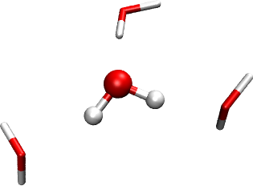

:orphan:

.. _pe_scf:

A Hartree-Fock calculation with the polarizable embedding model
===============================================================

In this tutorial we will cover the set up of an Hartree-Fock calculation using the
polarizable embedding (PE) model (:cite:`Olsen2010`, :cite:`Olsen2011`) to include
effects from a surrounding environment. Our example concerns a solvent effect, but the
PE model is general and can also handle other environments (e.g. proteins or mixed
solvents). The implementation of the algorithm in DIRAC is documented in the paper
:cite:`Hedegaard2017`, and we refer to this paper for further technical details.
Our target system for this tutorial is a water molecule surrounded (or "microsolvated") 
by three other water molecules. The system is shown in the figure below. The molecule in 
ball-and-stick representation is the one that is described with Hartree-Fock, and the 
three other water molecules are represented by an explicit PE potential. The underlying 
structure is abstracted from an MD simulation on a larger water 
cluster :cite:`Kongsted2002`. In real production calculations, PE would be used for the 
full system (PE is targeted for much larger environments than three molecules), but our 
system is sufficient to show how the setup works. 

The current implementation employs the external library
`PElib <https://gitlab.com/pe-software/pelib-public>`_ for the PE-related tasks.
The module is activated through the key-word `.PEQM` under `**HAMILTONIAN` 
flag. A few additional (but also very simple) examples can be found in the test 
directories.

The .mol file (h2o.mol) for the central water molecule is shown below. The more 
experienced user will notice that the format is exactly the same as for a 
vacuum calculation.::

   INTGRL
   H2O structure, taken from Kongsted et al. (2002)
   ------------------------
   C   2    0
           8.0   1
   O    0.0000000000   0.000000000    0.0000000000
   LARGE BASIS 6-31++G
           1.0   2
   H   -1.4301431032   0.000000000    1.1073930799
   H    1.4301431032   0.000000000    1.1073930799
   LARGE BASIS 6-31++G
   FINISH

The .inp file (pe-hf.inp) is given below. The PElib module is activated through the 
key-word `.PEQM` under `**HAMILTONIAN` .::

   **DIRAC
   .TITLE
   H2O with PE
   .WAVE FUNCTION
   .PEQM            ! enable PElib
   *PEQM            ! PE-related keywords
   .POTENT          ! Specify what PE potential to use
   3_h2o_trimer.pot ! name of the used PE potential! name of the used PE potential
   **INTEGRALS
   *TWOINT
   .SCREEN
   1.0D-12
   *READIN
   .UNCONT
   **WAVE FUNCTIONS
   .SCF
   *SCF
   .CLOSED SHELL
   10
   *END OF

Specification of `.PEQM` will thus make the program calculate the PE-specific term of 
the Fock (or Kohn-Sham) matrix and add them to the vacuum part (see Eqs. (19)-(22) 
in :cite:`Hedegaard2017`). PE-related keywords are given under `*PEQM`. It is also 
under this flag we specify the file containing the PE potential (3_h2o.pot). 
This potential has to be generated but for now, we can use a pre-generated potential 
given below. The potential contains coordinates for three water molecules surrounding 
the central water. The three water molecules are represented by multipoles up to 2. 
order and anisotropic dipole-dipole polarizabilities::
 
   ! potential: 3_h2o.pot
   ! ------------------
   ! Multipole moments:
   ! ------------------
   !        TYPE: DALTON-LoProp
   !      METHOD: DFT
   !      XC-FUN: CAMB3LYP
   !   BASIS SET: loprop-6-31+G*
   ! -----------------
   ! Polarizabilities:
   ! -----------------
   !        TYPE: DALTON-LoProp
   !      METHOD: DFT
   !      XC-FUN: CAMB3LYP
   !   BASIS SET: loprop-6-31+G*
   ! -----------------
   @COORDINATES
   9
   AA
   O     2.36500000   -0.26700000    1.17000000
   H     2.26100000   -1.10300000    1.62300000
   H     3.13200000   -0.39000000    0.61100000
   O     0.60500000   -1.46500000   -2.08000000
   H     1.56100000   -1.47200000   -2.03300000
   H     0.33300000   -0.92000000   -1.34100000
   O    -2.76000000   -0.37900000    1.04500000
   H    -3.11300000   -0.71800000    0.22300000
   H    -3.08300000   -0.98500000    1.71200000
   @MULTIPOLES
   ORDER 0
   9
    1   -0.71214000
    2    0.35613000
    3    0.35601000
    4   -0.71172000
    5    0.35592000
    6    0.35580000
    7   -0.71195000
    8    0.35605000
    9    0.35589000
   ORDER 1
   9
    1    0.18080000   -0.26163000   -0.02886000
    2    0.02828000    0.15363000   -0.09058000
    3   -0.14340000    0.01302000    0.10892000
    4    0.18641000    0.14653000    0.21409000
    5   -0.18048000    0.00772000   -0.00000000
    6    0.06166000   -0.10108000   -0.13640000
    7   -0.18419000   -0.25746000   -0.04234000
    8    0.06167000    0.05571000    0.16046000
    9    0.05571000    0.10834000   -0.13341000
   ORDER 2
   9
    1   -4.26483000    0.09135000   -0.61915000   -4.18829000   -0.42704000   -4.30439000
    2   -0.44339000    0.02690000   -0.02255000   -0.13348000   -0.16450000   -0.36591000
    3   -0.19077000   -0.05251000   -0.18965000   -0.43313000    0.03146000   -0.31920000
    4   -3.75473000   -0.26370000   -0.29217000   -4.64173000    0.46544000   -4.36137000
    5   -0.04700000    0.00328000    0.02886000   -0.45150000    0.00785000   -0.44444000
    6   -0.41521000   -0.05871000   -0.07885000   -0.32164000    0.18442000   -0.20640000
    7   -4.75797000    0.31610000    0.08263000   -4.49207000   -0.18934000   -3.50706000
    8   -0.39388000    0.06405000    0.12905000   -0.39012000    0.12442000   -0.15864000
    9   -0.40305000    0.09738000   -0.09242000   -0.27989000   -0.17467000   -0.26011000
   @POLARIZABILITIES
   ORDER 1 1
   9
    1    4.27640000    0.35715000    0.52792000    3.89073000    0.26437000    4.59489000
    2    0.42029000    0.22994000    0.06545000    2.24667000   -0.89940000    0.97487000
    3    1.98744000   -0.26213000   -0.97060000    0.39136000    0.31466000    1.26588000
    4    3.86307000   -0.04205000   -0.13378000    4.67372000   -0.64393000    4.23650000
    5    2.71461000    0.04981000    0.19272000    0.51208000   -0.15905000    0.42003000
    6    0.43352000   -0.33472000   -0.47532000    1.31851000    0.93618000    1.89744000
    7    4.64952000   -0.67410000   -0.13594000    4.15079000    0.04738000    3.96576000
    8    0.88018000    0.20475000    0.75848000    0.75651000    0.80933000    2.00627000
    9    0.82484000    0.41178000   -0.61423000    1.44166000   -1.04482000    1.38018000
   EXCLISTS
   9 3
    1 2 3
    2 1 3
    3 1 2
    4 5 6
    5 4 6
    6 4 5
    7 8 9
    8 7 9
    9 7 8
   
   
Now we have all ingredients for starting the calculation::

   pam --inp=pe-hf.inp --mol=h2o.mol --put="3_h2o.pot" 

The output file will be named pe-hf_h2o.out. When the calculation is converged, the final 
energy report contains an additional entry; the "Embedding energy". The total energy 
already includes this contribution::

                                   TOTAL ENERGY
                                   ------------

   Electronic energy                        :    -85.261494639123399

   Other contributions to the total energy
   Nuclear repulsion energy                 :      9.195432882420004
   Embedding energy                         :     -0.063104845058299
   SS Coulombic correction                  :      0.000000028807992

   Sum of all contributions to the energy
   Total energy                             :    -76.108136383446379

A Kohn-Sham DFT calculation can be run in exactly the same manner, sinmply by specifying DFT 
under `**HAMILTONIAN` instead. We look at DFT in connection with calculation of molecular 
property calculalations in another tutorial. 

A few things to note: 

* Currently, PE is only implemented for Hartree-Fock and Kohn-Sham DFT.
* X2C Hamiltonian works with PE, but the embedding operator is not transformed.  

