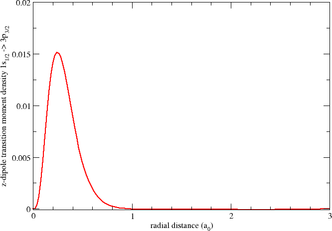

:orphan:

====================================
Excitation energies at the SCF-level
====================================

In this tutorial we will look at the theory behind the calculation of excitation energies at the SCF-level, that is, 
either by time-dependent Hartree-Fock (TD-HF) or TD-DFT. The implementations in DIRAC are presented in :cite:`Bast2009`.

Excitation energies :math:`\omega_m` are found by solving the generalized eigenvalue problem

.. math::

   \left(E_0^{[2]}-\hbar\lambda S^{[2]}\right)X_m=0;\qquad (1)

where the matrices :math:`E_0^{[2]}` and :math:`S^{[2]}` are the electronic Hessian and generalized metric, respectively. From their structure, it can be shown that solution vectors
come in pairs

.. math::

   \lambda_{+;n}=+\left|\omega_{n}\right|,\,\boldsymbol{X}_{+;n}=\left[\begin{array}{c}
   \boldsymbol{Z}_{n}\\   \boldsymbol{Y}_{n}^{\ast}\end{array}\right],\quad
   \lambda_{-;n}=-\left|\omega_{n}\right|,\,\boldsymbol{X}_{-;n}=\left[\begin{array}{c}
   \boldsymbol{Y}_{n}\\\boldsymbol{Z}_{n}^{\ast}\end{array}\right].

Transition moments associated with operator :math:`\hat{h}_{A}` for transitions :math:`n\leftarrow0` are generally calculated as

.. math::

   \langle n|\hat{h}_{A}|0\rangle=\boldsymbol{X}_{+;n}^{\dagger}\boldsymbol{E}_{A}^{[1]};\qquad (2)

   
where appears solution vector :math:`\boldsymbol{X}_{+;n}^{\dagger}` and
property gradient :math:`\boldsymbol{E}_{A}^{[1]}`. The property gradient
is given by 

.. math::

   \boldsymbol{E}_{B}^{[1]}=\left[\begin{array}{c}\boldsymbol{g}_{B}\\\Theta_{hB}\boldsymbol{g}_{B}^{\ast}\end{array}\right];\quad g_{B;ai}=-h_{B;ai}.

An important generalization above is that, in addition to Hermitian
operators :math:`\hat{h}_{B}` (:math:`\Theta_{hB}=+1`), imposed by the tenets
of quantum mechanics, we also allow anti-Hermitian ones (:math:`\Theta_{hB}=-1`). 
   

A key to computational efficiency is to consider a decomposition of
solution vectors in terms of components of well-defined Hermiticity
and time reversal symmetry. Using a pair of solution vectors :math:`\boldsymbol{X}_{+}` 
and :math:`\boldsymbol{X}_{-}`, we may form Hermitian and anti-Hermitian
combinations 

.. math::

   \begin{array}{lcl}
   \boldsymbol{X}_{h} & = &\frac{1}{2}\left(\boldsymbol{X}_{+}+\boldsymbol{X}_{-}\right)=\left[\begin{array}{c}
   \boldsymbol{Z}+\boldsymbol{Y}\\
   \boldsymbol{Y}^{\ast}+\boldsymbol{Z}^{\ast}
   \end{array}\right]=\left[\begin{array}{c}
   \boldsymbol{h}\\
   \boldsymbol{h}^{\ast}
   \end{array}\right]\\
   \boldsymbol{X}_{a} & = & \frac{1}{2}\left(\boldsymbol{X}_{+}-\boldsymbol{X}_{-}\right)=\left[\begin{array}{c}
   \boldsymbol{Z}-\boldsymbol{Y}\\
   \boldsymbol{Y}^{\ast}-\boldsymbol{Z}^{\ast}
   \end{array}\right]=\left[\begin{array}{c}
   \boldsymbol{a}\\
   -\boldsymbol{a}^{\ast}
   \end{array}\right].
   \end{array}

   
The inverse relations therefore provide a separation of solution vectors
into Hermitian and anti-Hermitian contributions

.. math::

   \boldsymbol{X}_{+}=\boldsymbol{X}_{h}+\boldsymbol{X}_{a};\quad\boldsymbol{X}_{-}=\boldsymbol{X}_{h}-\boldsymbol{X}_{a}.

Further decomposition of each contribution into time-symmetric and
time-antisymmetric parts give vectors that are well-defined with respect
to both Hermiticity and time reversal symmetry

.. math::

   \boldsymbol{U}^{\dagger}\left(\Theta_{h},\Theta_{t}\right)=\left[\begin{array}{cccccccc}
   \boldsymbol{c}^{\dagger} & \boldsymbol{d}^{\dagger} & \Theta_{t}\boldsymbol{c}^{T} & \Theta_{t}\boldsymbol{d}^{T} & \Theta_{h}\boldsymbol{c}^{T} & \Theta_{h}\boldsymbol{d}^{T} & \Theta_{h}\Theta_{t}\boldsymbol{c}^{\dagger} & \Theta_{h}\Theta_{t}\boldsymbol{d}^{\dagger}\end{array}\right]

where

.. math::

   c_{ai} = x_{ai}\quad\mbox{and}\quad d_{ai} = x_{a\overline{i}}

and the index overbar refers to a Kramers' partner in a Kramers-restricted
orbital set. The scalar product of such vectors is given by :cite:`Saue2002a`

.. math::
   
   \boldsymbol{U}_{1}^{\dagger}\left(\Theta_{h1},\Theta_{t1}\right)\boldsymbol{U}_{2}\left(\Theta_{h2},\Theta_{t2}\right)=
   \left(1+\Theta_{h1}\Theta_{h2}\Theta_{t1}\Theta_{t2}\right)\left[z+\Theta_{h1}\Theta_{h2}z^{\ast}\right];\quad
   z=\left(\boldsymbol{c}_{1}^{\dagger}\boldsymbol{c}_{2}+\boldsymbol{d}_{1}^{\dagger}\boldsymbol{d}_{2}\right),

and one may therefore distinguish three cases

.. math::

   \boldsymbol{U}_{1}^{\dagger}\left(\Theta_{h1},\Theta_{t1}\right)\boldsymbol{U}_{2}\left(\Theta_{h2},\Theta_{t2}\right)=\begin{cases}
   0 & ;\quad\Theta_{h1}\Theta_{h2}=-\Theta_{t1}\Theta_{t2}\\
   4Re\left[z\right] & ;\quad\Theta_{h1}\Theta_{h2}=\Theta_{t1}\Theta_{t2}=+1\\
   4iIm\left[z\right] & ;\quad\Theta_{h1}\Theta_{h2}=\Theta_{t1}\Theta_{t2}=-1
   \end{cases}.\quad (3)

One may show that Hermiticity is conserved when multiplying such a trial vector
by the electronic Hessian, whereas it is
*reversed* by the generalized metric. However, both the electronic Hessian
and the generalized metric conserves time reversal symmetry. The implication
is that the time-symmetric and time-antisymmetric components of a
solution vector does not mix upon solving the generalized eigenvalue
problem, and one can dispense with one of them. From a physical point of view, this
can be understood from the observation that excited states can be
reached through both time-symmetric and time-antisymmetric operators.
In order to employ the quaternion symmetry scheme, we choose to work
with the time-symmetric vectors. It follows from the above 
that their scalar product are either zero or real. In practice, a
property gradient is therefore always contracted with the component
of the solution vector having the same hermiticity, so that all transition
moments are real.

Practical example
=================

We consider the excitation :math:`1s_{1/2}\rightarrow 3p_{3/2}\,(\left|m_{j}\right|=1/2)` 
of the magnesium atom. We limit attention to boson irrep :math:`B_{1u}`, corresponding to the symmetry of the :math:`z` - coordinate (:math:`\Gamma_z`). 
We work within the electric dipole approximation and from a character
table of :math:`D_{2h}` it is clear that we will only get non-zero transition
moments from the z-component of the electric dipole operator.

We start from the menu file `ed.inp`

.. literalinclude:: ed.inp

and the xyz-file `Mg.xyz`

.. literalinclude:: Mg.xyz

and run our calculation using::

  pam --inp=ed --mol=Mg.xyz --outcmo --get "PAMXVC"

We are keeping some file for later use, see below. It can be seen in the menu file `ed.inp` that excitations are only allowed from the first *gerade* orbital (:math:`1s_{1/2}`) to the sixth *ungerade* one (:math:`3p_{3/2,1/2}`).
The nature of these orbitals can be seen from the Mulliken population analysis in the output.

We have increased the print level significantly in order to be able to look a bit under the hood.
Let us first look at the property gradient 

.. math::

   g_{ai}\rightarrow-\langle3p_{3/2;1/2}|\hat{\mu}_{z}|1s_{1/2;{\color{red}+1/2}}\rangle;\quad g_{a\overline{i}}\rightarrow-\langle3p_{3/2;1/2}|\hat{\mu}_{z}|1s_{1/2;{\color{red}-1/2}}\rangle;\quad\hat{\mu}_{z}=-ez.

The matrix element :math:`g_{ai}` may be written as

.. math::

   g_{ai}=-\int\Omega_{ai}\left(\boldsymbol{r}\right)\hat{\mu}_{z}\left(\boldsymbol{r}\right)d^{3}\boldsymbol{r};
   \quad\Omega_{ai}\left(\boldsymbol{r}\right)=\phi_{a}^{\dagger}\left(\boldsymbol{r}\right)\phi_{i}\left(\boldsymbol{r}\right)

and similar for :math:`g_{a\overline{i}}`. For present purposes it suffices to think in terms of 2-component
spinors. Since :math:`s_{1/2}` and :math:`p_{3/2}` have opposite parity, they
will in the conventions of DIRAC have different symmetry structures

.. math::

   s_{1/2}\rightarrow\left[\begin{array}{c}
   \left(\Gamma_{0},\Gamma_{R_{z}}\right)\\
   \left(\Gamma_{R_{y}},\Gamma_{R_{x}}\right)
   \end{array}\right];\quad p_{3/2}\rightarrow\left[\begin{array}{c}
   \left(\Gamma_{xyz},\Gamma_{z}\right)\\
   \left(\Gamma_{y},\Gamma_{x}\right)
   \end{array}\right].

In addition we have to remember the relation between Kramers partners

.. math::
   
   \phi=\left[\begin{array}{c}
   \phi^{\alpha}\\
   \phi^{\beta}
   \end{array}\right];\quad\overline{\phi}=\left[\begin{array}{c}
   -\phi^{\beta\ast}\\
   \phi^{\alpha\ast}
   \end{array}\right].

In terms of symmetry the orbital distributions are

.. math::

   \Omega_{\left(p_{3/2};s_{1/2}\right)}=\left(\Gamma_{xyz},\Gamma_{z}\right);\quad\Omega_{\left(p_{3/2};\overline{s_{1/2}}\right)}=\left(\Gamma_{y},\Gamma_{x}\right).

In the present case the operator symmetry is :math:`\Gamma_{z}`. Since
the integrand of the matrix element has
to be totally symmetric, we see that only the imaginary part of :math:`g_{ai}` 
will be non-zero; the partner element :math:`g_{a\overline{i}}` is strictly
zero. The generally complex gradient elements are combined into a
quaternion one

.. math::

   ^{Q}g_{AI}=g_{ai}+g_{a\overline{i}}\check{j}

and, indeed, when we look in the output we find

.. literalinclude:: propgrad.txt

Here the notation *EpolLnlXnxYnyZnz* refers to a Cartesian electric multipole operator :math:`\hat{Q}^{[nl]}=-ex^{nx}y^{ny}z^{nz};\quad nx+ny+nz=nl`.
Since this is a time symmetric, Hermitian operator, it will be contracted with the Hermitian part of the solution vector. In this particular case we
have only a single orbital rotation, and between two orbitals of positive energy, so the relevant part of the solution vector is

.. literalinclude:: E+_solvec.txt

Searching in the output, we find the corresponding calculated transition moment

.. literalinclude:: tmom.txt

which is easily seen to be :math:`2*0.35355084*-0.00682451`. (With respect to Eq.(3) a factor two seems to be missing; this is appears to be connected to the scaling of
eigenvectors in subroutine XPPORD.)

We may proceed to visualize the transition moment density 

.. math::

   T(\boldsymbol{r})=-\sum_{ai}x^{\ast}_{+;n;ai}\Omega_{ai}\left(\boldsymbol{r}\right)\hat{\mu}_{z}\left(\boldsymbol{r}\right)

as a radial distribution, that is   

.. math::

   T(r) = \int_{0}^{2\pi}\int_{0}^{\pi}T(\mathbf{r})r^2\sin\theta d\theta d\phi

As preparation we first inspect the file PAMXVC of solution vectors

.. literalinclude:: rspread.txt

We see that the Hermitian e-e part of the solution vector E+ is the first vector on the file, which therefore leads us to set up the input file `length.inp` as

.. literalinclude:: length.inp

We now generate the radial distribution using::

  pam --inp=length --mol=Mg.xyz --incmo --put "PAMXVC" --get "plot.radial.scalar=length.dat"

First we may note at the end of the output

.. literalinclude:: radint.txt

and so we see that the radial distribution integrates to the value obtained in our previous calculation.

Next, with a suitable plotting program (I used `xmgrace <https://plasma-gate.weizmann.ac.il/Grace/>`_) we can visualize the radial distribution 

To get some idea of the extent of the z-electric dipole moment transition density associated with the :math:`1s_{1/2}\rightarrow 3p_{3/2}\,(\left|m_{j}\right|=1/2)` transition, I have included in the input the calculation of orbital sizes as :math:`<r^2>^{1/2}=\left(<x^2>+<y^2>+<z^2>\right)^{1/2}`. Extracting and using the data from the output I obtain the following table (orbital labels are taken
from the Mulliken analysis of the first calculation):

+-----+-----------------+---------------+---------------+---------------+---------------------+
|Sym. | Orb.            | :math:`<x^2>` | :math:`<y^2>` | :math:`<z^2>` | :math:`<r^2>^{1/2}` |
+-----+-----------------+---------------+---------------+---------------+---------------------+
| E1g |	 1s 1/2;  1/2   |    0.008      |    0.008	|   0.008	|      0.151          |
+-----+-----------------+---------------+---------------+---------------+---------------------+
| E1g |	 2s 1/2;  1/2   |    0.190      |    0.190	|   0.190	|      0.754          |
+-----+-----------------+---------------+---------------+---------------+---------------------+
| E1g |	 3s 1/2;  1/2   |    4.106	|    4.106      |   4.106       |      3.510          |
+-----+-----------------+---------------+---------------+---------------+---------------------+
| E1u |	 2p 1/2;  1/2   |    0.198	|    0.198      |   0.198       |      0.772          |
+-----+-----------------+---------------+---------------+---------------+---------------------+
| E1u |	 2p 3/2; -3/2   |    0.240      |    0.240	|   0.120       |      0.774          |
+-----+-----------------+---------------+---------------+---------------+---------------------+
| E1u |	 3p 3/2;  1/2   |    0.160      |    0.160      |   0.279	|      0.774          |
+-----+-----------------+---------------+---------------+---------------+---------------------+

We see that the radial distribution peaks around 0.25 :math:`a_0` which is slightly outside the size of the :math:`1s_{1/2}` orbital.
