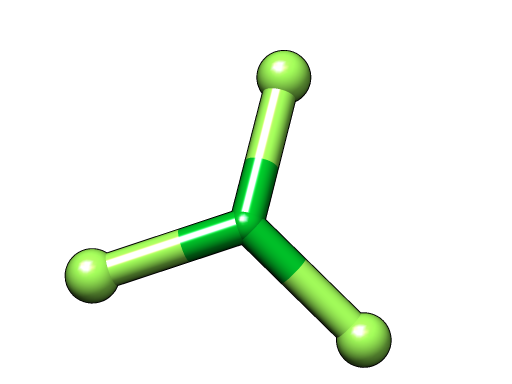

:orphan:
 

.. _atomic_huckel_start:

Extended Huckel start
=====================

Background
----------

The basis theory is given here: :cite:`Hoffman1963`.

The present development was further motivated by :cite:`Norman2012`.

The particularity of the present approach is that it employs pre-calculated atomic fragments.

A start guess is generated by solving the following general eigenvalue problem

.. math::

   H\mathbf{c} = S\mathbf{c}\varepsilon

where :math:`S` is the overlap matrix in terms of pre-calculated atomic orbitals. 
The Hamiltonian matrix is defined as

.. math::

   H_{ij} = \left\{\begin{array}{lcl}\epsilon_i;&\quad&i=j\\KS_{ij};&\quad&i\ne j\end{array}\right.

where :math:`K` is the Wolfsberg-Helmholtz constant. The default value is 1.75, but it can be changed with the keyword :ref:`SCF_.HUCPAR`.

Example
-------

We consider a Kohn-Sham calculation of the closed-shell :math:`LuF_3` molecule using the PBE functional.
We start from the molecular input file `LuF3.xyz`

.. literalinclude:: LuF3.xyz

and the menu file `PBE.inp`

.. literalinclude:: PBE.inp

Unfortunately, and curiously, this calculation does not converge

.. literalinclude:: PBE_LuF3.out

We therefore try the extended Hückel method for a better start guess. The input file `PBEhuc.inp` 
reads

.. literalinclude:: PBEhuc.inp

In addition to the keyword :ref:`SCF_.AD HOC` file names for the Lu and F atomic types are given, followed 
by orbital strings specifying what atomic orbitals to select (see
:ref:`orbital_strings` for the syntax).
The calculation now converges in 20 iterations

.. literalinclude:: PBEhuc_LuF3.out

