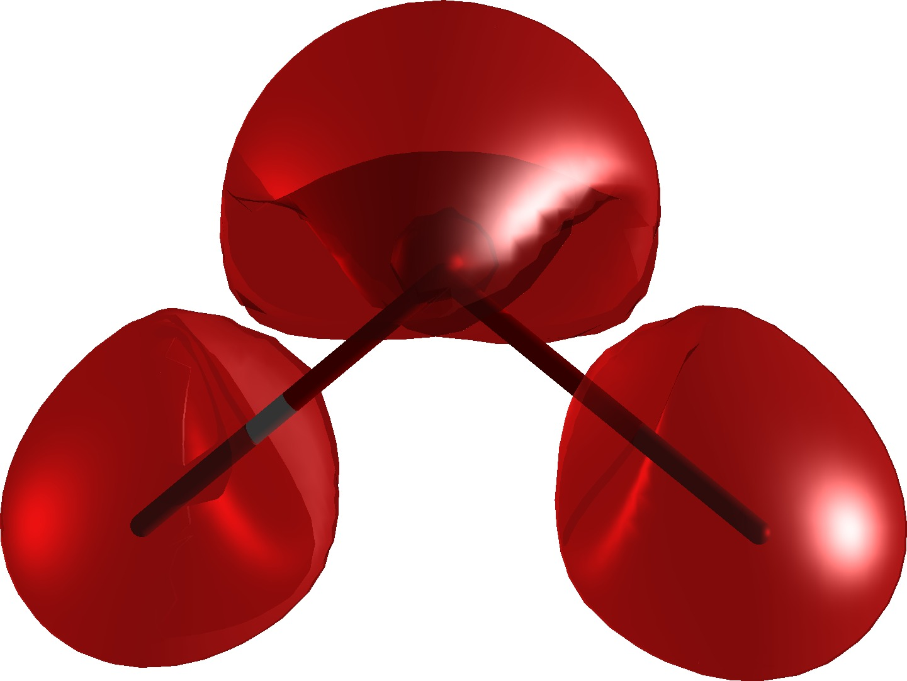

:orphan:

Magnetizability density
=======================

In this tutorial we will plot the CGO magnetizability density of the water
molecule.  We will do this in two steps: first we will run the SCF and response
calculation and save the CHECKPOINT.h5, PAMXVC, and RESPONSE.h5 files, then we will restart from
these and calculate the magnetizability density on a grid of points and write
this into a cube file which can be opened by your favorite molecular
visualization program (the author of this tutorial likes Avogadro).

Tip: it might be helpful to check the analysis of other magnetic response densities
in a Jupyter notebook in 
:file:`../../../../demo_notebooks/visual_overview.ipynb`.

Getting the wave function and the response vectors
--------------------------------------------------

Let us use the following molecule input (h2o.mol):

.. literalinclude:: h2o.mol

Together with a simple job input (magnetizability.inp):

.. literalinclude:: magnetizability.inp

We can get the wave function with the following run script:

.. literalinclude:: magnetizability.run

After running the script you should see the files CHECKPOINT.h5 and PAMXVC in your
submit directory.

And here is the magnetizability tensor::

              Total magnetizability tensor (au)
              ---------------------------------

                       Bx                  By                  Bz

  Bx        -1.804460514289     -0.000000000000     -0.000000000001
  By        -0.000000000000     -1.617444735515      0.000000000000
  Bz        -0.000000000001     -0.000000000000     -1.709814652525

Plotting the magnetizability density
------------------------------------

We will use the following run script to generate the cube file:

.. literalinclude:: density.run

Together with the following job input (density.inp):

.. literalinclude:: density.inp

Finally you can open cube files with your favorite program and visualize the
density. You can sum up all contributions to the total density or plot
specific components or paramagnetic and diamagnetic contributions
separately.

And this is how the total magnetizability density of water looks (isosurface 0.04 a.u.):

